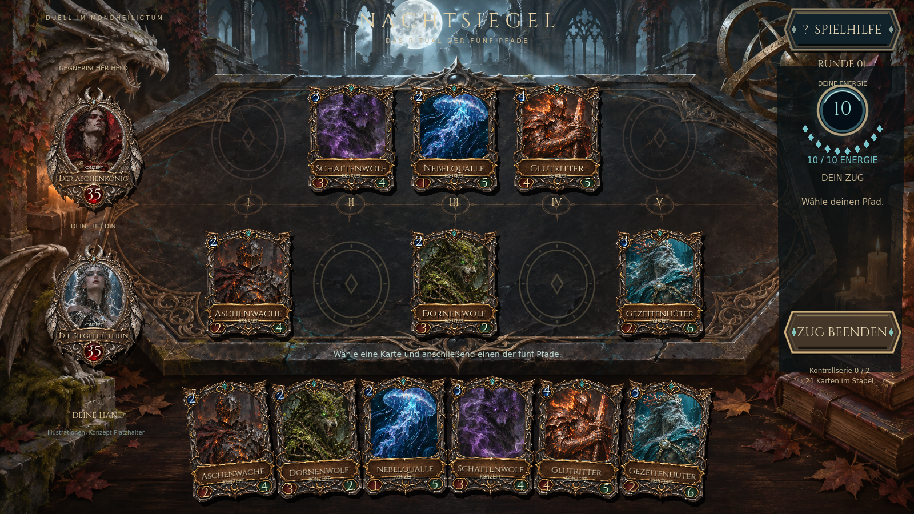

# NACHTSIEGEL

Eigenständiges Dark-Fantasy-Kartenduell in Godot 4.6.3, für Querformat auf iPhone und Android gestaltet. Fünf Pfade, illustrierte Reliquienkarten, Obsidianarena und lokaler KI-Gegner.



**Direkt spielen:** https://jagarex-lab.github.io/nachtsiegel-app/

## Spielen

`project.godot` in Godot 4.6.3 öffnen und F6/F5 starten. Handkarte antippen, anschließend Zielpfad wählen. Zauber können auch direkt auf die gegnerische Kreaturenkarte gespielt werden. **Karte ansehen** öffnet die Großansicht; **Spielhilfe** erklärt Kampf und Siegbedingungen. Nach Sieg/Niederlage startet **Neues Duell** eine frische Partie.

Getestete Änderungen auf `develop` werden automatisch auf der Spielseite veröffentlicht und dort erneut im Browser geprüft. Der Entwicklungsstand baut auf `develop` auf. Die vorhandenen lokalen Spielregeln bleiben erhalten; dieser Stand ist kein nachgewiesener vollständiger Port des älteren [Webspiels](https://jagarex-lab.github.io/duel-deck/).

## Prüfen und exportieren

```bash
# Godot 4.6.3 und ein X11-Display, z. B. Xvfb :99, erforderlich
DISPLAY=:99 tools/test.sh

# Passende offizielle Godot-Exportvorlagen installieren
mkdir -p work/build/web
godot --headless --path . --export-debug 'Linux QA' work/build/nachtsiegel.x86_64
godot --headless --path . --export-debug 'Web QA' work/build/web/index.html
# Android SDK und Java unter Editor Settings → Export → Android konfigurieren
godot --headless --path . --export-debug 'Android QA' work/build/nachtsiegel-debug.apk
```

`tools/test.sh` legt Godot-Benutzerdaten ausschließlich unter `work/` ab. Exportvorlagen müssen daher unter diesem XDG-Datenverzeichnis verfügbar sein, wenn dieselben Umgebungsvariablen für den Export verwendet werden. Binärdateien, SDK, Debug-Schlüssel und temporäre Dateien werden nicht eingecheckt.

[Aktuelle Grafikstufe und Tests](docs/QA-SANCTUM-2026-11-08.md) · [Erste Überarbeitung](docs/QA-2026-11-08.md) · [Asset-Herkunft](assets/ASSET_MANIFEST.md)

Godot: MIT. Projektcode und Spielinhalte: bestehender Rechtevorbehalt laut `LICENSE-NOTICE.md`. Illustrationen sind ausdrücklich als KI-Konzept-Platzhalter gekennzeichnet.
