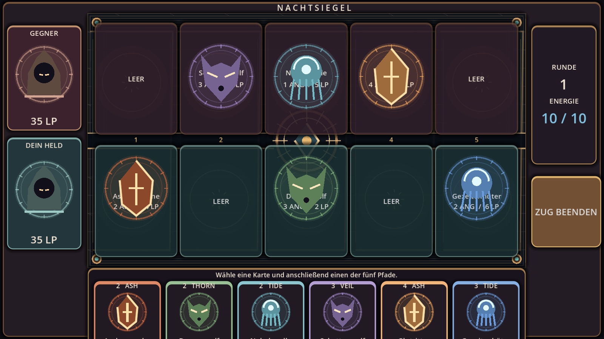
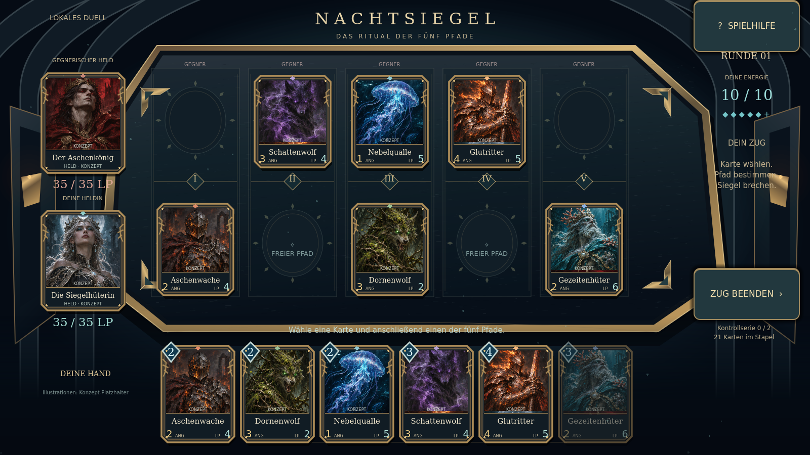
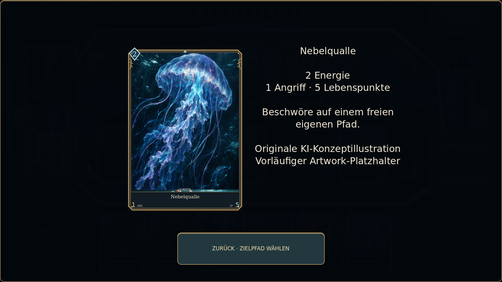
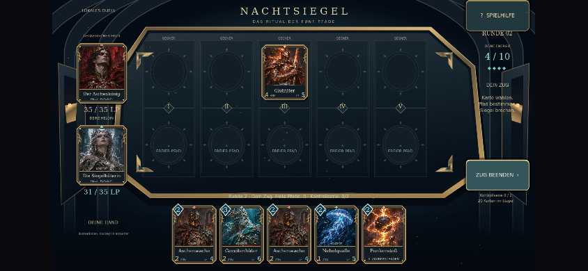

# NACHTSIEGEL — Arena-Überarbeitung, 08.11.2026

Entwicklungsbasis: `develop`, Commit `0e15ac4`. Arbeitsbranch: `feature/arena-quality`. Geprüft mit Godot **4.6.3 stable**, Linux, Xvfb und Mesa llvmpipe; Web zusätzlich mit Playwright/Chromium und SwiftShader. Kein Store-Release, kein Pages-Deployment, kein Merge auf `develop` oder `main`.

## Ergebnis

Die Debug-Spalten wurden durch einen zusammenhängenden, perspektivisch geformten Obsidianaltar mit steinernen Einfassungen, vergoldeten Beschlägen, fünf eingravierten Pfaden, kalter Grundbeleuchtung und warmen Feuerpunkten ersetzt. Sieben individuelle KI-Konzeptillustrationen und zwei Heldenporträts ersetzen die geometrischen Platzhalter. Metallrahmen, Juwelen, Lebens-/Angriffswerte und Spielhilfe gehören zu einer gemeinsamen Gestaltung.

Karten reagieren beim Auswählen; Ziehen, Beschwören, Zaubertreffer, Angriffe, Schaden und Tod haben sichtbares Feedback. Während der Angriffsanimation sperrt das Zugende doppelte Eingaben. Eine Großansicht zeigt Artwork, Werte, Kartentyp und Zielregel. Vollständige Partien, Sieg/Niederlage und Neustart sind spielbar. Die fünf Pfade und das lokale Regelwerk bleiben erhalten.

## Screenshots

Die Vorher-/Nachher-Spielfelder zeigen denselben ausdrücklich **inszenierten Prüfzustand**, damit die Gestaltung vergleichbar ist; sie behaupten keine aus einer echten Partie entstandene Spielsituation.

| Vorher (`develop`) | Neue Arena |
|---|---|
|  |  |

[Startzustand](screenshots/arena-initial.png) · [Auswahl](screenshots/arena-selected.png) · [844×390, sechs Karten](screenshots/landscape-844x390.png) · [915×412](screenshots/landscape-915x412.png) · [Hochformat-Hinweis](screenshots/portrait-390x844.png)

Der letzte Screenshot stammt aus dem exportierten Spiel mit normalem Startzustand und tatsächlichem Playwright-Touch auf „Zug beenden“, ohne Zustandsinjektion. Runde 2, gegnerische Kreatur, neue Energie und verursachter Heldenschaden sind sichtbar.

## Prüfungen

| Prüfung | Ergebnis / Beleg |
|---|---|
| Import und GDScript | Keine Skript-/Parserfehler; [Importprotokoll](qa/import.log) |
| Regelregression | **684 Prüfungen, 0 Fehler**; 30 Duelle gegen eingefrorene ursprüngliche Spielregeln; [Protokoll](qa/rules.log) |
| Eingaben und Layout | **137 Prüfungen, 0 Fehler**; [Protokoll](qa/input-layout.log) |
| Renderdurchlauf | Start, belegte Pfade, Auswahl, Großansicht und Sechserhand ohne Laufzeitfehler; [Protokoll](qa/visual.log) |
| Linux-Export | Erfolgreich; anschließend exportierte Binärdatei mit echtem Renderpfad gestartet; [Build](qa/build-linux.log), [Laufzeit](qa/packaged-linux.log) |
| Webexport | Erfolgreich, ohne Threads, Desktop-/Mobiltexturen; [Build](qa/build-web.log) |
| Browserlauf | 1280×720 und 844×390, Touch-Zugende; keine JavaScript-/Konsolenfehler; [Ergebnis](qa/browser-results.json) |
| Android-Export | Debug-APK erfolgreich erstellt, ausgerichtet und signiert; arm64-v8a und x86_64; [Build](qa/build-android.log) |
| APK-Prüfung | Signatur v2/v3 bestätigt; Paket `com.jagarex.nachtsiegel`, Version `0.2.0-arena-qa`, minSDK 24, targetSDK 36; [Signatur](qa/android-signature.log), [Manifest](qa/android-manifest.log) |

Die GUI-Prüfung injiziert echte Godot-Maus- und `InputEventScreenTouch`-Ereignisse statt nur Spielfunktionen direkt aufzurufen. Abgedeckt: Auswahl, Beschwörung, Zauber auf Gegnerkarten, Zugende einschließlich Doppeltipp-Sperre, Öffnen/Schließen der Großansicht, sechs Handkarten und alle fünf Pfade innerhalb des Viewports. Viewports: **1600×900, 1280×720, 844×390, 915×412, 1024×768**; zusätzlich Hochformat und Zurückdrehen. Handkarten, Pfade und Hauptaktionen erreichen in diesen simulierten Querformaten mindestens 44 Pixel pro Touch-Dimension.

Die Regelprüfung erfasst unter anderem Energiekosten, belegte Felder, zwei Beschwörungen, Zauberziele, direkte Heldentreffer, gerichteten Kampf, Lebenspunktsieg, Niederlage, Kontrollsieg und das Sechser-Handlimit. Der Vergleichscode stammt aus `0e15ac4`; ausschließlich Darstellungshooks wurden entfernt. Der Deckaufbau verwendet jetzt denselben gesetzten RNG statt einer unabhängigen globalen Zufallsquelle, damit Start und Diagnose reproduzierbar sind. Das lokale Regelwerk ist weiterhin kein nachgewiesener vollständiger Port der historischen Webregeln.

## Entwicklungs- und Korrekturzyklen

1. Ausgangszustand geprüft und als Screenshot gesichert; Godot-Benutzerdaten aus dem schreibgeschützten Home-Verzeichnis nach `work/xdg` verlegt.
2. Arena, Original-Konzeptatlas, Reliquienrahmen und HUD vollständig neu gestaltet. Zu lange Kartennamen eingepasst, irreführenden Angriffswert bei Helden entfernt, große Hauptaktionen und lesbare Karteninspektion ergänzt.
3. Reale GUI-Ereignisse deckten `can_process`-Fehler beim sofortigen Entfernen eines gerade angeklickten Buttons auf. Handaktualisierung auf das Ende der Eingabeverarbeitung verschoben; vollständiger Durchlauf anschließend ohne diesen Fehler.
4. Mobile Exportvalidierung scheiterte an fehlendem ETC2/ASTC-Import. Projekteinstellung ergänzt; Linux- und Webexport bestanden. Passende offizielle Exportvorlagen einschließlich der Non-Thread-Webvorlagen eingerichtet.
5. Android-SDK eingerichtet. `sdkmanager` konnte die Paketlisten in dieser Proxy-Umgebung nicht laden; offizielle Google-Pakete per HTTPS heruntergeladen und lokal eingerichtet. APK-Export und unabhängige Signaturprüfung bestanden. Build-Tools 35 wurden vom Exporter für das Target-36-Template akzeptiert; der entsprechende Hinweis steht im Protokoll.
6. Exportiertes Webspiel in Chromium gestartet und per Touch bedient. Die ursprüngliche Testabfrage wartete auf ein ausgeblendetes Ladeelement; Godot entfernt dieses Element. Abfrage korrigiert und beide Browsergrößen erfolgreich geprüft.

## Verbleibende Grenzen

- **Kein physischer iPhone-/Android-Test.** Simulierte Touch-Ereignisse und Browsergrößen ersetzen keine Geräteprüfung. Native Safe Areas, Lesbarkeit unter realen Bedingungen, thermisches Verhalten, Akku, Unterbrechungen und Hintergrund-/Vordergrundwechsel bleiben offen.
- **Kein iOS-Build.** Dieser Linux-Rechner hat weder macOS/Xcode noch Apple-Signierung. [Native Einrichtung](IPHONE-SETUP.md).
- **Android nicht gestartet.** Keine angeschlossene Hardware bzw. eingerichtetes Emulator-Image; ADB konnte in der Sandbox seinen Standardordner `/home/agent/.android` nicht anlegen. Der Nachweis umfasst Export, Paket und Signatur, nicht die native Laufzeit.
- Software-Rendering meldet erwartungsgemäß fehlende V-Sync-Umschaltung. Audio wurde im Renderprüflauf über den Dummy-Treiber geführt; das Spiel enthält noch keine finale Audioproduktion.
- Kleine Kartentexte sind auf schmalen Displays nur in der Großansicht gut lesbar. Mindest-Touch-Flächen wurden in Viewport-Pixeln geprüft, nicht physisch in Punkten/mm vermessen. Die feste 16:9-Komposition wird auf breiteren Displays mit seitlichen Sicherheitsrändern zentriert.
- Illustrationen sind ausdrücklich KI-Konzept-Platzhalter. [Herkunft und Schriftenlizenzen](../assets/ASSET_MANIFEST.md).

## Reproduzieren

`DISPLAY=:99 tools/test.sh` führt Import, Regel-, GUI- und Screenshot-Tests aus und schlägt bei `ERROR`, Skriptfehler oder fehlgeschlagener Prüfung fehl. `tests/visual.gd` erzeugt reproduzierbare Zustandsbilder. Für den Browserexport einen lokalen HTTP-Server auf Port 8765 starten und `CHROMIUM_BIN=/usr/bin/chromium node tools/browser_qa.cjs` ausführen; alternativ einen von Playwright installierten Chromium verwenden.

Der aktualisierte GitHub-Workflow führt Tests und Browserexport aus und archiviert Prüfmaterial. Er besitzt keine Pages-/Deployment-Berechtigungen und veröffentlicht keine Spielversion. Der neue Workflow selbst ist bis zu einem erfolgreichen GitHub-Lauf als CI-Konfiguration, nicht als bereits bestätigter Remote-Test zu verstehen.
