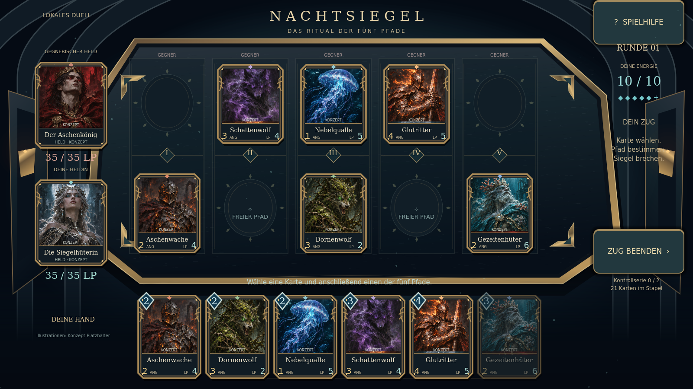
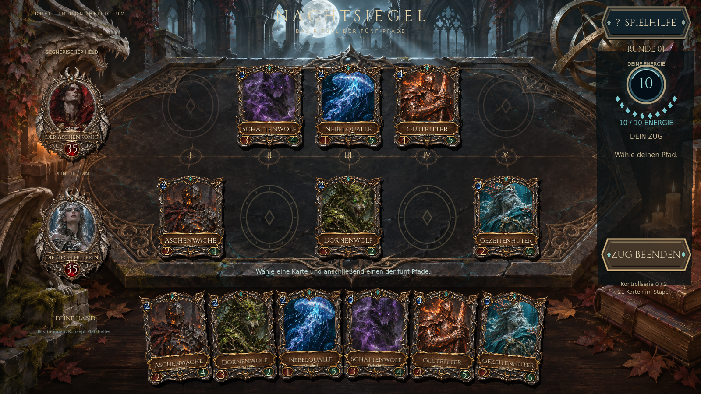
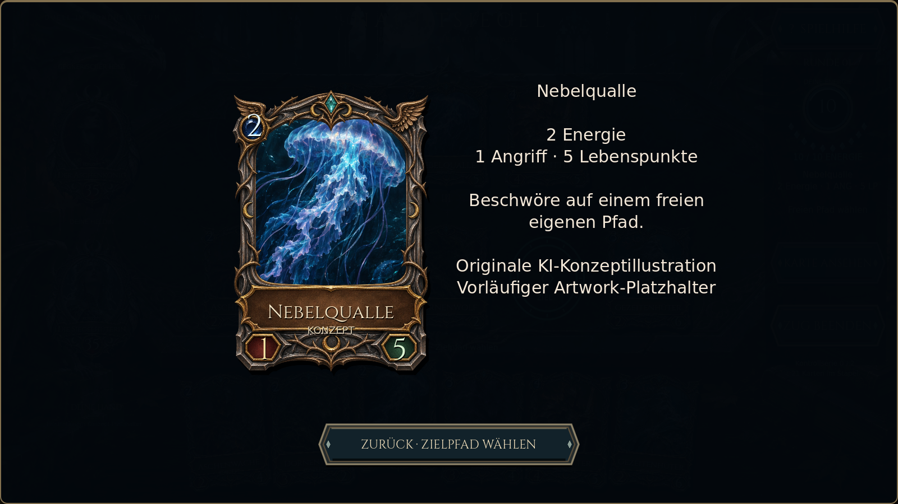
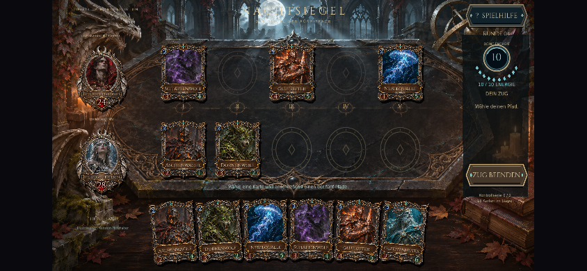
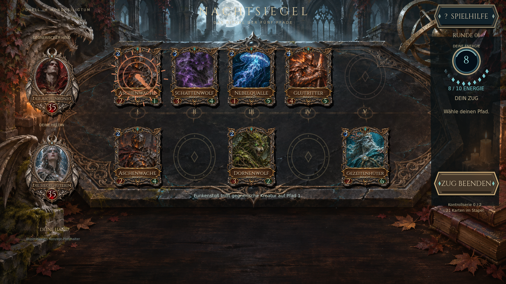

# Mondheiligtum — zweite visuelle Entwicklungsstufe

Basis: veröffentlichter Stand `9e5eb3c`. Entwicklung auf `feature/arena-quality`, Veröffentlichung nach bestandenen Prüfungen über `develop`. Das bestehende lokale Regelwerk und die fünf Pfade bleiben erhalten.

## Sichtbare Änderungen

- Illustrierte Kathedralen-Arena mit bearbeitetem Obsidian, geschnitztem Metall, Kerzen, Mondlicht und räumlichem Hintergrund ersetzt die flache Vektorgrafik.
- Hochaufgelöste transparente Reliquienfassungen statt gezeichneter Polygonrahmen. Kartenillustration, Kosten, Name, Angriff und Lebenspunkte werden separat zusammengesetzt und bleiben dynamisch.
- Heldenporträts in eigenen Metallmedaillons mit eingelassenen Lebenspunkt-Edelsteinen.
- Manuell angeordnete, leicht gefächerte Handkarten; Auswahl hebt die gewählte Karte hervor. Neue Karten gleiten ein. Alle sechs Karten bleiben sichtbar.
- Neue Cinzel-Typografie, eingefasste Aktionsschaltflächen, Energie-Orb mit zehn Kristallen und gravierte Beschwörungsfelder. Gültige Ziele pulsieren.
- Shader-basiertes Kerzenlicht, schwebende Staubpartikel und Glut, fraktionsgefärbte Beschwörungskreise, Zauberflug und Trefferfunken sowie ein kurzer Rundenhinweis.
- Karten mit zu wenig Energie lassen sich zur Großansicht auswählen. Die unveränderte Kostenprüfung verhindert weiterhin das Ausspielen.

## Vergleich und Screenshots

Die Vergleichsfelder sind absichtlich inszenierte identische Prüfzustände; sie sind keine Behauptung einer natürlich entstandenen Partie.

| Bisher veröffentlicht | Mondheiligtum |
|---|---|
|  |  |

Die Rahmen, Medaillons und Arena sind eigens generierte KI-Konzeptassets; die Kennzeichnung der Kartenillustrationen bleibt sichtbar. [Asset-Herkunft und Schriftenlizenz](../assets/ASSET_MANIFEST.md).

## Entwicklungs- und Prüfzyklen

1. Den veröffentlichten Stand als Ausgangsbild gesichert. Neue Arena und transparente Rahmen erstellt, integriert und im tatsächlichen Godot-Renderer angesehen.
2. Fünf Pfade mit den eingravierten Siegeln ausgerichtet, Kartenhand auf eine manuell gefächerte Anordnung umgestellt, eigene Hero-Fassungen und neue Typografie integriert.
3. Regeldifferenztests bestanden. Die GUI-Prüfung wurde erweitert: tatsächliche transformierte Ecken der gedrehten Karten statt nur ihrer ungedrehten Rechtecke; zusätzlich Kartenauswahl/Großansicht bei fehlender Energie und weiterhin gesperrtes Ausspielen.
4. Die Screenshotprüfung fand eine Überlagerung der Großansicht durch höher gezeichnete Handkarten. Modalfenster und Hochformatabdeckung erhalten jetzt explizit höhere Zeichenebenen. Die erneute Großansicht zeigt keine überlagerten Handkarten und einen sichtbaren Rückweg.
5. Zeichentests warten nun auf das Ende der Ziehanimation, damit Übersichtsbilder vollständig eingeblendete Karten zeigen. Die Kameraaufnahme des Zaubertreffers bleibt absichtlich eine Momentaufnahme des Effekts.

## Lokale Prüfergebnisse

| Prüfung | Ergebnis |
|---|---|
| Godot-Import / Skripte / Shader | Keine Skript- oder Shaderfehler; [Import](qa/sanctum/import.log), [Renderlauf](qa/sanctum/visual.log) |
| Regelregression | **684 Prüfungen, 0 Fehler**; 30 Duelle gegen die eingefrorenen bisherigen Regeln; [Log](qa/sanctum/rules.log) |
| GUI, Touch und Layout | **272 Prüfungen, 0 Fehler**; [Log](qa/sanctum/input-layout.log) |
| Linux-Export und Paketstart | Erfolgreich; [Build](qa/sanctum/build-linux.log), [Laufzeit](qa/sanctum/packaged-linux.log) |
| Android-Export | Debug-APK `0.3.0-mondheiligtum`, arm64 und x86_64; [Build](qa/sanctum/build-android.log), [Manifest](qa/sanctum/android-manifest.log) |
| Android-Signatur | APK-Signatur v2/v3 bestätigt; [Prüfung](qa/sanctum/android-signature.log) |

Zusammen **956 bestandene Prüfungen**. Querformatgrößen: 1600×900, 1280×720, 844×390, 915×412 und 1024×768; zusätzlich Hochformat und Zurückdrehen. Die GUI-Prüfung verwendet tatsächliche Godot-Maus- und ScreenTouch-Ereignisse. Sie prüft Handkanten, Touch-Größe, Auswahl, Beschwörung, Zauberziel, Zugende/Doppeltipp-Sperre und Karteninspektion. Auch alle vier transformierten Ecken jeder gefächerten Karte bleiben nach dem Einziehen innerhalb des Bildschirms.

Die nativen Build-Protokolle enthalten den bekannten Hinweis auf verwendete Build-Tools 35 für das Target-36-Template sowie den nicht verfügbaren ADB-Daemon; die APK-Erstellung und Signaturprüfung sind dennoch erfolgreich. Web-/Live-Prüfungen werden mit dem abschließenden GitHub-Lauf protokolliert. Veröffentlichung erfolgt ausschließlich hinter dem vorhandenen Test-Gate; der Workflow prüft danach die erwartete öffentliche Build-Version und Touch-Zugende in zwei Browsergrößen.

## Grenzen und nächste Qualitätsstufen

Diese Stufe verbessert die Materialität und Präsentation deutlich; sie ist kein Nachweis einer fertigen kommerziellen Art-Produktion. Individuell gemalte finale Kartenillustrationen, weitere Fraktionsfassungen, aufwendigere zeitlich getrennte Kampfinszenierung und fertige Audioproduktion bleiben weitere Entwicklungsarbeit.

Die kleinen Texte auf Handkarten werden über die Großansicht lesbar. Eine feste 16:9-Komposition wird auf breiteren Telefonen zentriert. Die Tests prüfen Viewport-Pixel, keine physisch gemessenen Touch-Flächen. Echte iPhone-/Android-Geräte, Mobile Safari, native Safe Areas und thermische Dauerlast sind hier weiterhin nicht verifiziert; ein iOS-Build benötigt macOS/Xcode. Ein erfolgreicher APK-Export ist kein nativer Gerätetest.
