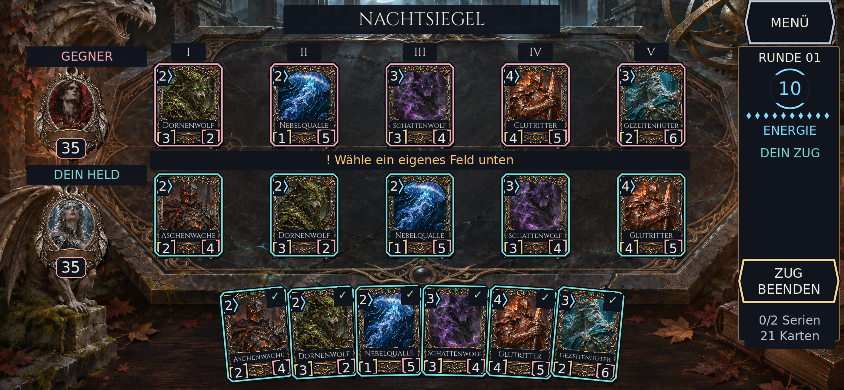

# NACHTSIEGEL – UX/UI-Abnahme, 09.11.2026

Die bestehende Mondheiligtum-Arena wurde in ihrer Bedienung, Hierarchie und Lesbarkeit überarbeitet. Illustrationen, Helden und Reliquienrahmen bleiben erhalten; es gibt keine neuen Kartenmotive, Kartenregeln oder Pfade. Basis: `f6f182f` auf `develop`, Umsetzung: `feature/ux-contrast`.

## Audit und Korrekturen

| Bereich | Befund im Ausgangsstand | Umgesetzte Korrektur |
|---|---|---|
| Arena / Hierarchie | Text und Ziergrafik konkurrierten; breite Smartphones verschenken Platz | Dunkle Textflächen, breite sichere Spielfläche, fünf beschriftete Pfade, getrennte Gegner-/Spielerzeile |
| Kartenwerte | Kleine Kosten und Werte; unklare Bedeutung | Mindestens 12 CSS-Pixel für Zahlen, getrennte Kosten-/Angriff-/Lebensformen, unverblasste Werte |
| Kartenname / Regeln | Lange Namen in kleinen Rahmen nicht vollständig lesbar | Einfache Auswahl mit großem Fokusnamen, zweites Antippen oder DETAILS öffnet Inspector; vollständige Werte und Regeln |
| Auswahl / Ziele | Spielbarkeit und Auswahl nicht ausreichend getrennt | Spielbar ✓; ausgewählt dicker Goldrand und Anhebung; gültiges Ziel grünes ✓; ungültig amberfarbenes × und konkrete Rückmeldung |
| Nicht bezahlbar / gesperrt | Nur Farbänderung wäre missverständlich | !-Markierung und Energiehinweis; in Kampfphase gesperrte Aktionen und sichtbare Phasenanzeige |
| Helden | Winzige Namensschrift im Medaillon | Lebenspunkte auf dunklem Schild; große Seitenüberschrift; Portrait antippen öffnet Namen, Leben und Siegbedingungen |
| Energie / Zugende | Zu kleine Bedienelemente bei Browserleisten | Cyan-Energieanzeige, Aktionsflächen mindestens 44×44 CSS-Pixel, breiter Zugende-Knopf bei geringer Höhe |
| Hinweise / Fehler | Dauertext und Überlagerungen | Kontextuelle erste drei Schritte; danach ausgeblendet, Lernfortschritt gespeichert; Fehler mit ! und Text |
| Inspector / Hilfe / Menü | Lange Texte können unten abgeschnitten werden | Adaptive Schrift und Umbruch, vollständig sichtbare Rückkehraktion; Menü und Hilfe bis 844×300 geprüft |
| Animation / Kampf | Verblassende Werte verlieren Kontrast | Deckend gezeichnete Kartenwerte und Schadenszahlen; kurze Bewegungen unter den Werten; reduzierte Bewegung wählbar und gespeichert, Systempräferenz übernommen |
| Spielende | Ergebnis und erneuter Start müssen eindeutig sein | Sieg-/Niederlagendialog, Grund, Weiter ansehen und Neues Duell; Karten nach Spielende nur lesend ansehen |
| Web / iPhone | Geräte-Pixel und CSS-Pixel unterscheiden sich; WebKit meldete Framebufferfehler | CSS-Dichteumrechnung, sichere Insets, dynamische Viewport-Höhe; antialiasierter Canvas nutzt Emscriptens unterstützten Textur-Ausgabepfad ohne den WebKit-Blitfehler |

Die neue Palette ist zentral in `scripts/ui_tokens.gd`. Semantische Zustände haben zusätzlich Form, Symbol, Text oder räumliche Veränderung. Dekoratives Metall ist kein alleiniger Zustandsträger.

## Farbkonzept und Kontrast

Grundfläche `#10141d`, erhöhte Fläche `#1c2532`, Schatten/Trennkontur `#080c13`.

| Rolle | Farbe | Kontrast auf Grundfläche |
|---|---|---|
| Primärer Text | `#f3ede2` | 15.81:1 |
| Sekundärer Text | `#bfc4ce` | 10.53:1 |
| Hauptaktion / ausgewählt | `#f3d48a` | 12.80:1 |
| Eigene Seite | `#79ddd4` | 11.50:1 |
| Gegnerseite | `#edabb7` | 9.75:1 |
| Energie | `#81ddff` | 12.04:1 |
| Spielbar / gültiges Ziel | `#a0edb8` | 13.42:1 |
| Ungültig / nicht bezahlbar | `#ffc57d` | 11.87:1 |
| Schaden / Leben | `#ffaaa4` | 10.12:1 |
| Tastatur- und Hoverfokus | `#d6e3ff` | 14.29:1 |
| Inaktive Information | `#9eaaba` | 7.82:1 |

### Tatsächlich gerenderte Messung

49 eingefrorene Zustände wurden jeweils zweimal gerendert: normal und mit ausschließlich ausgeblendeter semantischer Schrift/Kontur. Layout, Animation und Hintergrund bleiben identisch. `tools/contrast_report.py` prüft die beabsichtigte Vordergrundfarbe gegen **jeden tatsächlich gerenderten Hintergrundpixel innerhalb der transformierten Messfläche**, auch bei gedrehten Handkarten. Antialias-Randpixel gelten nicht als beabsichtigte Schriftfarbe. Dekorative Illustrationspigmente werden nicht als Text gewertet.

- **2.042 Messflächen, 0 Unterschreitungen.**
- 1.616 Textflächen: Mindestwert **9,125:1**, gefordert mindestens 4,5:1. Auch große Texte werden mit 4,5:1 geprüft.
- 426 wesentliche Konturen/Symbole: Mindestwert **8,312:1**, gefordert mindestens 3:1.
- Vollständige Messwerte: [contrast-report.json](qa/ux/contrast-report.json).

Anfangs zeigten die Messungen Probleme an hellen Rahmen und bei ausblendenden Schadenszahlen. Diese wurden durch tatsächlich deckende Schriftunterlagen, getrennte Konturen und den Verzicht auf Text-Ausblendungen behoben. Es wurden keine Grenzwerte abgesenkt. Dies ist eine gezielte Kontrast- und Bedienprüfung, keine vollständige WCAG-Zertifizierung des Canvas-Spiels.

## Vorher / nachher – dieselben Querformat-Fixtures

Die Ausgangsbilder wurden aus dem unveränderten Ausgangscommit mit denselben Kartendaten und 844×390 erzeugt. Alle Bilder sind echte Godot-Screenshots.

| Zustand | Vorher | Nachher |
|---|---|---|
| Start | [Bild](screenshots/ux/before-start-844x390.png) | [Bild](screenshots/ux/start-844x390.png) |
| Auswahl | [Bild](screenshots/ux/before-selected-844x390.png) | [Bild](screenshots/ux/selected-valid-844x390.png) |
| Fünf belegte Pfade und sechs Handkarten | [Bild](screenshots/ux/before-full-board-844x390.png) | [Bild](screenshots/ux/full-board-six-hand-844x390.png) |
| Karteninspector | [Bild](screenshots/ux/before-inspection-844x390.png) | [Bild](screenshots/ux/inspection-844x390.png) |

Weitere Nachweise: [ungültiges Ziel](screenshots/ux/invalid-844x390.png), [Zauberziele](screenshots/ux/spell-targets-844x390.png), [Kampf](screenshots/ux/combat-844x390.png), [Sieg](screenshots/ux/victory-844x390.png), [Niederlage](screenshots/ux/defeat-844x390.png), [Hilfe bei 844×300](screenshots/ux/safe-area-help-844x300.png).

## Entwicklungs- und Testzyklen

1. Ausgangsstand und identische Vergleichs-Fixtures sichern; Regeln unverändert als Differentialreferenz prüfen.
2. Zentrale Palette, semantische Karten und Slots, Inspector, Hilfen und responsive Querformat-Fläche implementieren; Import- und Eingabetests ausführen.
3. Gepaarte Screenshots messen; Rahmenüberschneidungen, Textkontrast während Animationen und Textbeschnitt korrigieren; erneut vollständig rendern und prüfen.
4. Kurze Fenster und sichere Ränder ergänzen; Touch-Flächen, Dialogumbrüche und Menüabstände korrigieren. Tatsächliche Geräte-Pixel in CSS-Pixel umrechnen.
5. Chromium und WebKit mit echten Touch-Ereignissen prüfen; WebKit-Ausgabefehler beheben und exportierten Build erneut prüfen. CI führt diese Prüfungen vor dem Pages-Upload aus und wiederholt sie auf der öffentlichen Spieladresse.

## Reproduzierbare Tests

`DISPLAY=:99 tools/test.sh` mit Godot 4.6.3 und Pillow:

| Test | Ergebnis |
|---|---|
| Godot-Import / Skripte | Keine Skriptfehler |
| Regeln | **684 Assertions, 0 Fehler**, 30 Differential-Duelle gegen die unveränderte Referenz |
| Echte Maus-/ScreenTouch-Ereignisse und Layout | **380 Assertions, 0 Fehler**, sieben Querformate inklusive 844×320 und 915×350 |
| UX-Zustände und Geometrie | **1.894 Assertions, 0 Fehler**, 49 gepaarte Renderzustände |
| Bildbasierter Kontrast | **2.042 Flächen, 0 Fehler** |
| Linux-Export | Erfolgreich; exportierte ausführbare Datei gestartet |
| Android-Debug-Export | Erfolgreich; APK-Signaturen v2/v3 verifiziert; Version 0.4.0-ux |

Zusammen **2.958 Assertions** sowie die separaten Kontrastmessungen. Belege unter [qa/ux](qa/ux/).

Geprüft werden Start, Hover, Auswahl, gültige/ungültige Ziele, voller Tisch mit sechs Handkarten, Zauber, Inspector, fehlende Energie, Heldeninspector, Hilfe, Menü, reduzierte Bewegung, Kampf, Sieg und Niederlage. Zusätzliche Geometrieprüfungen erkennen beschnittene Labels, sich überschneidende Hauptaktionen, Aktionen außerhalb des sicheren Bereichs und zu kleine Touchflächen. Ein wirklicher Touch auf Neues Duell bestätigt die Rückkehr zu Runde 1, 35 Leben, vier Handkarten und drei Energie.

Browserlauf: Desktop Chromium 1280×720; Android/Chromium 915×412 und 844×320 (DPR 2); iPhone/WebKit 844×390 (DPR 3), 915×412 und 844×320 mit reduzierter Bewegung. Die kurzen Profile simulieren seitlich 44 Pixel und unten 21 Pixel sichere Ränder. Jeder Lauf prüft Auswahl, erneutes Antippen zum Inspector, Beschwörung mit genau einmaligem Energieverbrauch, Zugende, verschwindende Einführung, Umschalten reduzierter Bewegung sowie echte Viewport-Verkleinerung bis 300 Pixel Höhe. Desktop prüft tatsächlichen Browser-Vollbildmodus. Textgrößen und Touchflächen werden in CSS-Pixeln gemessen. Der Test fängt JavaScript- und Konsolenfehler ab.

## Grenzen

- WebKit-/Chromium-Geräteemulation ersetzt keinen physischen iPhone-/Android-Test. Native DPI-, Notch- und Home-Indikator-Werte sind auf Hardware noch zu bestätigen.
- Android wurde gebaut und signaturgeprüft, nicht auf einem angeschlossenen Gerät installiert. ADB steht ohne Gerät nicht bereit.
- Ein nativer iOS-Build und Store-Release benötigen macOS/Xcode und Signierung und wurden hier nicht ausgeführt.
- Kleine Karten sind eine Übersicht; vollständige lange Namen und Regeln stehen im leicht erreichbaren Inspector. Für wichtige Zahlen, Bedienelemente und Dialogtexte gelten die Mindestgrößenprüfungen.
- Die Einführung wurde automatisiert mit echter Eingabe geprüft; ein externer Nutzertest mit neuen Spielern steht aus.
- Illustrationen bleiben die bereits gekennzeichneten KI-Konzept-Platzhalter. Es wurde keine neue Bildserie erzeugt.

Lokal fehlende WebKit-Bibliotheken wurden aus offiziellen Debian-Paketen unter `work/` eingerichtet. CI installiert die Browser und ihre Systemabhängigkeiten über Playwright. Xvfb und Mesa ermöglichen echte Godot-Renderings; der Treiber kann im virtuellen Display kein VSync umschalten (Warnung, kein Skriptfehler).
