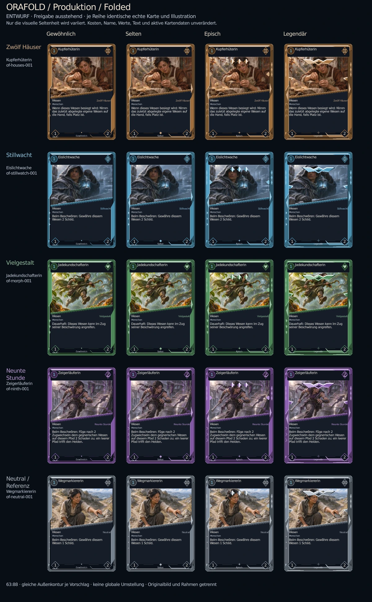
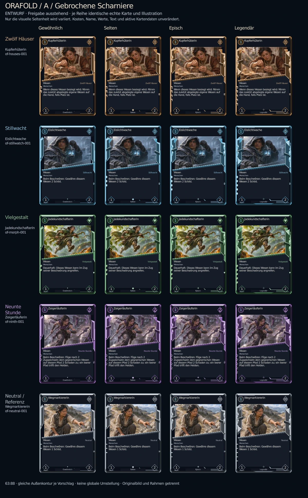
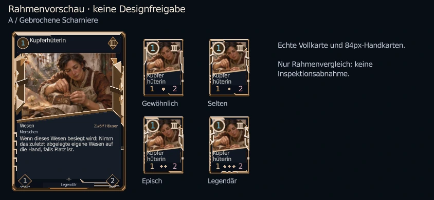
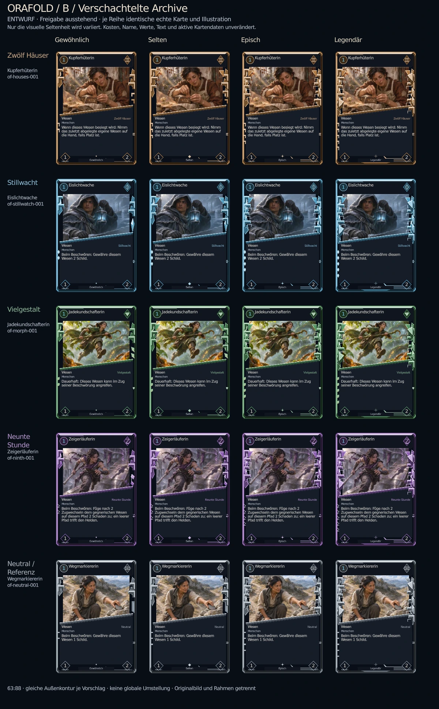
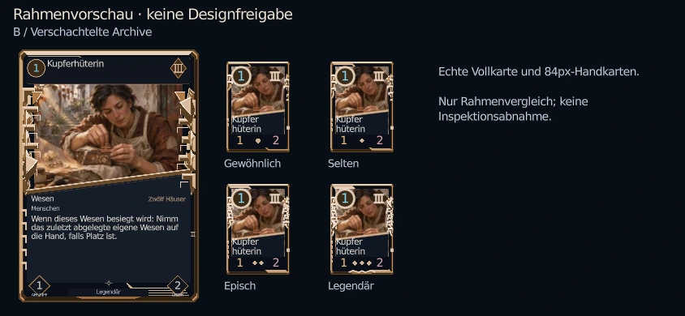
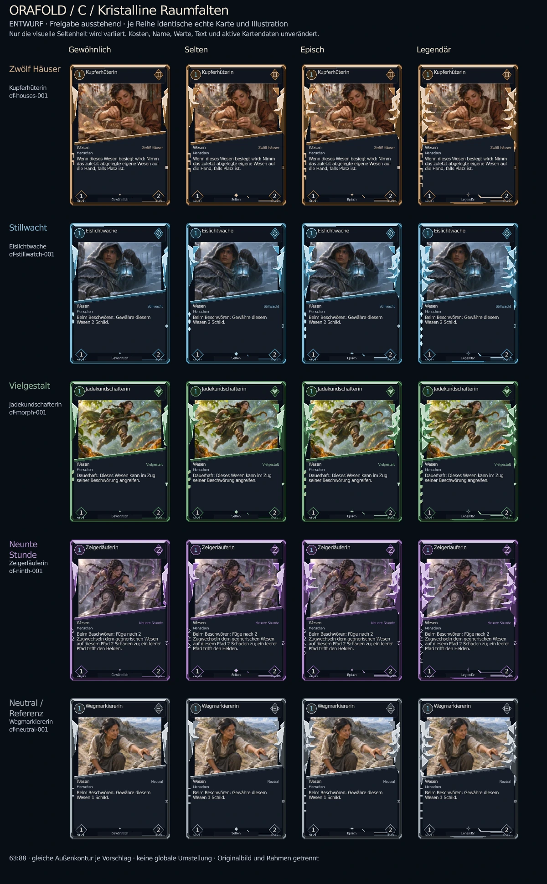
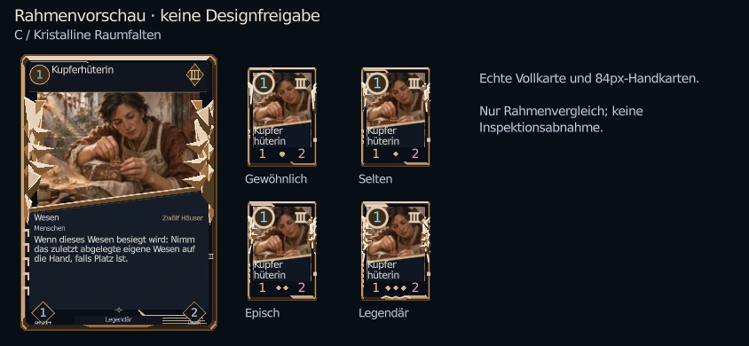

# Fractal-Fold – tatsächliche Godot-Vergleichsbilder

**Entwurf; keine Designfreigabe und keine globale Umstellung.**

Geprüfter Integrationscommit: `037acb29382b7056259388d79187009ec25397fe`.
Godot 4.6.3, native SubViewports, OpenGL-Kompatibilitätsrenderer.
WebP-Vorschauen aus den aktuellen PNG-Aufnahmen; keine Konzept-Mockups.
Die Quellkarte und Originalillustration bleiben innerhalb jeder Macht-Reihe
über alle vier Seltenheiten identisch. Nur die visuelle Seltenheit wird geändert.

Die fünf Reihen zeigen Zwölf Häuser, Stillwacht, Vielgestalt, Neunte Stunde
und Neutral; die Spalten Gewöhnlich, Selten, Episch und Legendär.
Die bisherige Produktion dient als Vorher-Referenz. A/B/C sind Vorschläge,
keine neuen aktiven Karten oder spielbaren Seltenheitsvarianten.

## Vorher: tatsächliche Produktionsrahmen

## A: Gebrochene Scharniere

Ruhige Flächen und durchgehende Gelenke lassen dem Motiv viel Aufmerksamkeit.

## B: Verschachtelte Archive

Offene rechteckige Verzweigungen betonen die strukturelle Komplexität.
Feine Linien müssen besonders auf kleinen Displays beurteilt werden.

## C: Kristalline Raumfalten

Geteilte Prismen liefern eine kräftige Materialwirkung, beanspruchen aber
mehr Bildrand als die ruhigeren Scharnierflächen.

## Reproduzierbare Nachweise

- [Vergleichslauf](comparison.json): **1.033 Assertions, 0 Fehler, 16 native PNGs**;
  tatsächliche Texturbindungen, Quellhashes und PNG-Hashes.
- [Masterrasterlauf](raster-comparison.json): **226.784 Assertions, 0 Fehler**;
  **60 tatsächliche Rastereinträge**, keine zusätzlich gespeicherten PNGs.
- Geometrievertrag: **1.474 Assertions, 0 Fehler**.
- [Methodik, Befunde, Testbefehle und Grenzen](../FRACTAL_FOLD_STUDY.md).

Diese Smartphoneansichten prüfen die Rahmenwirkung und die echte kompakte
Karte. Sie ersetzen weder den neuen Inspektionsablauf noch physische
iPhone-/Android-Gerätetests. Eine endgültige Rahmenauswahl bleibt offen.
