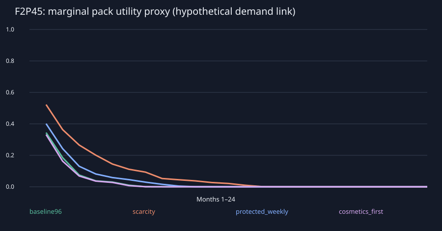
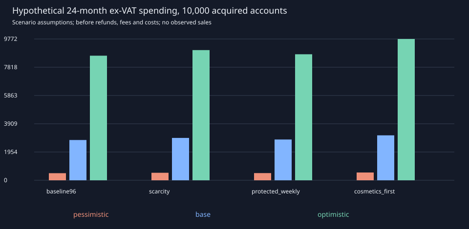

# Kommerzielle Tragfähigkeit: vorläufige Monetarisierungsanalyse

**Analyse und Simulation, keine aktivierte Produktwirtschaft.** Alle Geldbeträge, Retentionswerte, Kaufquoten, Kaufkörbe und Kosten sind unbestätigte Annahmen. Die Untersuchung ändert weder Echtgeldprodukte noch aktive Wirtschaftswerte oder Kampfregeln.

## Empfehlung

Den **geschützten kostenlosen Deckpfad** als nächsten Produktkandidaten testen: geringerer wiederholbarer Boosterzufluss, ein dauerhafter gezielter Zugangspfad und optionale Kosmetik beziehungsweise ein rein kosmetischer Saisonpass. Diese Empfehlung setzt den kostenlosen Zugang als Nebenbedingung voraus. Sie ist keine bestätigte Umsatz- oder Gewinnprognose. Das Knappheitsmodell erzeugt zusätzlichen Sammlungsbedarf, verstärkt aber bei bewusst stärkeren hohen Seltenheiten den wirtschaftlich bedingten Leistungsvorsprung. Ein bloßes Kürzen kostenloser Belohnungen ist deshalb keine ausreichende Lösung.

Die aktive Vergabe bleibt unverändert. Vor einem Produktentscheid müssen die unten ausgewiesenen Deckzugangs-, Nachfrage- und Kostenschwellen mit finalen Karten und freiwilligen Spieltests geprüft werden. Die Bezeichnung `protected_weekly` ist nur eine Szenario-ID: die Zielmeilensteine verfallen nicht wöchentlich.

## Reproduktion und Stichprobe

```sh
python3 tools/economy/simulate_monetization.py
python3 -m unittest discover -s tests -p "economy*_test.py" -v
```

Seed 56112026; 200 gepaarte Sammlungsläufe je Modell und Profil, 4000 Grundtrajektorien, 1000 Sensitivitätsläufe über 730 Tage. Finanzrechnung: 200 endliche Kohortenstichproben je Modell/Retentionsszenario, insgesamt 2400, über 24 Modellmonate.

CSV und JSON enthalten Mittelwerte, P05/P95 beziehungsweise Konfidenznäherungen. Streuung der Zufallsstichprobe und unbekannte Produktannahmen sind unterschiedliche Unsicherheiten. 200 erfolgreiche Läufe sind kein Beweis einer garantierten Spielerquote; für extreme Randfälle ist die Stichprobe zu klein. Nicht erreichte Zeitschwellen werden zensiert ausgewiesen, nicht als tatsächlicher Fertigstellungstag ausgegeben.

## Vier kontrollierte Wirtschaftsmodelle

| Modell | Wiederholbares Gold relativ | Boosterpreis in Gold | Zusätzlicher kostenloser Deckpfad |
|---|---:|---:|---|
| Bisherige Vergabe | 1.00 | 100 | Keiner |
| Sammlungsknappheit | 0.60 | 150 | Keiner |
| Geschützter Deckpfad | 0.65 | 100 | 4 × 300 zielgebundenes Herstellungsbudget bei 10/20/30/40 Partien |
| Kosmetikschwerpunkt | 1.00 | 100 | 4 × 300 zielgebundenes Herstellungsbudget bei 10/20/30/40 Partien |

Onboarding, vorhandene vier Starter, Pity, Seltenheitsraten, reguläre Herstellungskosten und bestehende XP-Meilensteine bleiben als Grundlage erhalten. Nur das wiederholbare Gold wird multipliziert; einmaliges Level-/Kampagnengold bleibt erhalten. Das zusätzliche Zielbudget ist eine **Analyseannahme für gebundene Zielkarten**, keine neu implementierte Währung. Es wird pro Konto höchstens einmal gewährt und nicht als unbeschränkte Sammlungskaufkraft gezählt.

Der vollständige Deckpfad umfasst zwölf gezielte Upgradekopien zusätzlich zu angenommenen Starterkopien. Die Kennzahl Schlüsselkarten umfasst eine Legende und zwei bestimmte epische Karten. Ab Tag 180 wird ein zweiter Warenkorb derselben Macht als Metawandel angenommen. Der synthetische Katalog beweist weder Decklegalität noch tatsächliche Matchup-Stärke.

## Kostenloser Fortschritt und Kaufvorsprung

| Modell | F2P45 kostenlose Booster Tag 30 | Schlüsselkarten komplett Tag 30 | Vollständiges Upgrade Tag 30 F2P45 | Dasselbe mit 40 Extra-Boostern/30 Tage |
|---|---:|---:|---:|---:|
| Bisherige Vergabe | 96 | 100.0% | 11.0% | 62.0% |
| Sammlungsknappheit | 55 | 100.0% | 0.5% | 11.5% |
| Geschützter Deckpfad | 77 | 100.0% | 100.0% | 100.0% |
| Kosmetikschwerpunkt | 96 | 100.0% | 100.0% | 100.0% |

| Modell | Zugang zu nutzbaren Kopien, seltenheitsgewichtet Tag 30 F2P45 | Vorsprung mit 40 Extra-Boostern: moderate / starke Gewichtung in Prozentpunkten | Zweites Upgrade Tag 180 F2P45 / mit 40 Extra-Boostern vollständig |
|---|---:|---:|---:|
| Bisherige Vergabe | 31.7% | 9.2 / 8.2 | 100.0% / 100.0% |
| Sammlungsknappheit | 21.4% | 10.1 / 8.9 | 47.5% / 100.0% |
| Geschützter Deckpfad | 27.4% | 9.5 / 8.4 | 100.0% / 100.0% |
| Kosmetikschwerpunkt | 32.0% | 9.1 / 8.1 | 100.0% / 100.0% |

Gewichte für gewöhnlich/selten/episch/legendär: moderat 1/1,5/2/3 und stark 1/2/4/8. Sie sind offengelegte Sensitivitätsannahmen für Zugang zu stärkeren Seltenheiten, keine geschätzten Siegwahrscheinlichkeiten. Trotz gleichem ersten Zieldeck bleibt durch breitere Kartenverfügbarkeit ein potenzieller Leistungsvorteil. Zwei feste Warenkörbe decken die Vielfalt einer realen Meta nicht vollständig ab.

Die Nachhol-Sensitivität spielt an nur drei Tagen je Woche und vergibt ausschließlich erreichte dauerhafte Matchmeilensteine. Die Ergebnisse sind in `collection_sensitivity.csv` enthalten; es wird keine tägliche Loginserie vorausgesetzt.

Die Kaufvergleiche verwenden dieselbe Spielzeit von 45 Minuten und dieselben Seeds. Dadurch wird der frühere Vergleich eines normalen mit einem zusätzlich viel aktiveren Budgetspieler entkoppelt. Die Boosterbudgets 4 und 40 sind Kartenfluss-Sensitivitäten. Sie sind keine Behauptung über eine tatsächlich beobachtete Ausgabenverteilung.

| Modell F2P45 | 90% einzigartige Karten: Median / zensiert | 95% einzigartige Karten: Median / zensiert | 90% spielbare Kopien: Median / zensiert | Sammlung Tag 365 | Durch Essenz bezahlbare einzigartige Sammlung Tag 365 |
|---|---:|---:|---:|---:|---:|
| Bisherige Vergabe | 133 / 0.0% | 183 / 0.0% | 229 / 0.0% | 99.8% | 100.0% |
| Sammlungsknappheit | 273 / 0.0% | 385 / 0.0% | 477 / 0.0% | 94.3% | 97.5% |
| Geschützter Deckpfad | 183 / 0.0% | 259 / 0.0% | 322 / 0.0% | 98.2% | 100.0% |
| Kosmetikschwerpunkt | 133 / 0.0% | 183 / 0.0% | 229 / 0.0% | 99.8% | 100.0% |

Die Zeitschwellen beziehen sich auf den Grundkatalog ohne Erweiterung. Bezahlbare Sammlung ist eine alternative Verwendung vorhandener regulärer Essenz, keine zusätzliche tatsächlich gebuchte Sammlung. Einzigartige Definitionen und spielbare Kopiensätze werden getrennt betrachtet.

## Schwächen 96 kostenlose Booster den Kaufanreiz?

**Für dauerhaft aktive Sammler: ja, sie verkürzen im Modell den Zeitraum mit wesentlichem zusätzlichem Sammlungsnutzen. Eine bestimmte Kaufquote lässt sich daraus nicht ableiten.** Die Zahl 96 ist zudem der erste Monat eines täglich aktiven 45-Minuten-Profils mit erledigten Aufgaben und Kampagnenbelohnungen. Sie ist kein gemessener Mittelwert aller Spieler. Spätere Monate enthalten weniger einmalige Einstiegsbelohnungen.

| Modell | Kostenlose Booster Monat 1 | Monat 3 | Monat 12 | Neue einzigartige Karten durch einen Extra-Booster Tag 30 | Tag 180 | Tag 360 |
|---|---:|---:|---:|---:|---:|---:|
| Bisherige Vergabe | 96 | 66 | 64 | 1.74 | 0.16 | 0.03 |
| Sammlungsknappheit | 55 | 32 | 31 | 2.62 | 0.60 | 0.23 |
| Geschützter Deckpfad | 77 | 47 | 45 | 2.06 | 0.34 | 0.06 |
| Kosmetikschwerpunkt | 96 | 66 | 64 | 1.74 | 0.15 | 0.03 |

Die letzte Spalte verwendet die nächstliegende Monatssonde Tag 360; genaue Proben für Tag 365 stehen in `collection_marginality.csv`. Neue epische/legendäre Definitionen, Duplikatessenz und verkürzte Zieldeckzeit stehen dort gesondert. Die Messung eines neuen Kartenfundes ist keine Zahlungsbereitschaftsmessung.



## Bindung, Kaufquote und Ausgabenannahmen

| Szenario | Hypothetische Bindung Tag 1 / 30 / 365 | Kaufabsicht je gebundenem Monat | Aktivitätsparameter Spieltage/Monat |
|---|---:|---:|---:|
| pessimistic | 25.0% / 3.5% / 0.2% | 1.5% | 6 |
| base | 40.0% / 8.0% / 1.2% | 4.0% | 10 |
| optimistic | 50.0% / 15.0% / 3.5% | 7.0% | 14 |

Alle Wirtschaftsmodelle teilen im kontrollierten Fall dieselben Bindungs- und Kaufabsichtsparameter. Es wird kein erfundener Bindungsbonus für das empfohlene Modell angenommen. Die Kurve beschreibt vereinfachte absorbierende Kohortenbindung, keine gemessene klassische Return-Retention und keinen Wiedereinstieg. Monatlich gebundene Konten, Aktivitätstage und tatsächliche zahlende Konten sind getrennte Kennzahlen.

Kaufkörbe sind disjunkte Gruppen mit möglichen Produktkombinationen innerhalb einer Gruppe. ARPPU wird aus Ausgaben geteilt durch tatsächlich zahlende Konten berechnet. Kaufabsicht vor Sammlungssättigung ist daher nicht gleich realisierte Käuferquote. Einsteigerpakete zählen einmal; der Pass wird freiwillig zu Saisonbeginn angeboten und enthält ausschließlich Kosmetik. Hypothetische Produktbudgets und Ausgabenmultiplikatoren sind in der Analysekonfiguration offengelegt. Steuerexklusive Modellbeträge sind keine genehmigten Preise.

Der Umsatz verwendet eine stark vereinfachte Verknüpfung mit dem zusätzlichen Sammlungsnutzen des `paid4`-Inventarprofils. Dieses spielt täglich; eine zeitgleiche Übertragung auf gelegentlich aktive Kunden kann die Sättigung überschätzen und die Nachfrage unterschätzen. Es gibt keine vollständige Rückkopplung zwischen individuellen Käufen, Inventaren und späteren Käufen. Das Verhalten bei Booster-Nachfragekollaps und geringer Kosmetiknachfrage wird deshalb gesondert ausgewiesen.

## Bedingte Umsatz- und Kostenrechnung

Eine einzelne Kohorte mit 10,000 erworbenen Konten, ohne weitere Zugänge, über 24 Modellmonate. Steuern werden nicht bestimmt; die Eingaben sind steuerexklusiv. Erstattungen (3%), Plattformabzüge (30%), variable Kosten, Fixkosten (5000 EUR/Monat) und angenommene Akquisitionskosten werden getrennt berücksichtigt.

| Annahme | Modell | Ausgaben vor Gebühren 12 Monate EUR | 24 Monate EUR | Deckungsbeitrag je gewonnenem Konto vor CAC/Fixkosten EUR | Ergebnis nach zugerechneten Fixkosten/CAC EUR |
|---|---|---:|---:|---:|---:|
| pessimistic | Bisherige Vergabe | 476 | 490 | 0.018 | -127820 |
| pessimistic | Sammlungsknappheit | 504 | 519 | 0.020 | -127801 |
| pessimistic | Geschützter Deckpfad | 482 | 497 | 0.018 | -127816 |
| pessimistic | Kosmetikschwerpunkt | 520 | 538 | 0.021 | -127789 |
| base | Bisherige Vergabe | 2526 | 2785 | 0.152 | -126476 |
| base | Sammlungsknappheit | 2671 | 2929 | 0.162 | -126378 |
| base | Geschützter Deckpfad | 2561 | 2820 | 0.155 | -126452 |
| base | Kosmetikschwerpunkt | 2801 | 3108 | 0.174 | -126260 |
| optimistic | Bisherige Vergabe | 7172 | 8616 | 0.513 | -122873 |
| optimistic | Sammlungsknappheit | 7559 | 9004 | 0.539 | -122611 |
| optimistic | Geschützter Deckpfad | 7271 | 8716 | 0.519 | -122806 |
| optimistic | Kosmetikschwerpunkt | 8056 | 9772 | 0.590 | -122101 |

| Basisszenario | P05 bis P95 der 24-Monats-Ausgaben EUR |
|---|---:|
| Bisherige Vergabe | 2530–3129 |
| Sammlungsknappheit | 2640–3285 |
| Geschützter Deckpfad | 2543–3179 |
| Kosmetikschwerpunkt | 2810–3422 |

Diese Bänder zeigen ausschließlich Zufallsstreuung der endlichen Kohorte bei festgehaltenen Annahmen. Die tatsächliche Unsicherheit über Bindung, Kaufinteresse und Ausgaben ist wesentlich größer und nicht durch dieses Band abgedeckt.



### Tatsächliche Käuferquote und durchschnittliche Ausgaben

| Szenario, geschützter Deckpfad | Realisierte Käuferquote Monat 1 | Ausgaben je zahlendem Konto Monat 1 EUR | Monat 12 EUR |
|---|---:|---:|---:|
| pessimistic | 1.36% | 10.88 | 8.00 |
| base | 3.62% | 10.88 | 8.00 |
| optimistic | 6.33% | 10.88 | 8.00 |

Die Werte gelten vor Gebühren und bei steuerexklusiven Eingaben. Monatlich zahlende Konten werden über Produkte hinweg einmal gezählt; die Summe der Zahler-Monate ist keine Anzahl unterschiedlicher Jahreskunden. Saisonbeginn und Einmalangebot beeinflussen den Monatsvergleich.

| Geschützter Deckpfad: Ausgabenmultiplikator bei unveränderter Kaufabsicht | Deckungsbeitrag pro gewonnenem Konto vor CAC/Fixkosten EUR |
|---|---:|
| 0.5× | 0.059 |
| 1.0× | 0.155 |
| 2.0× | 0.346 |
| 4.0× | 0.729 |

Die Multiplikatoren variieren hypothetische Ausgaben, nicht empirisch geschätzte Preiselastizitäten. Unterstellte höhere Budgets beweisen keine Nachfrage bei einem höheren tatsächlichen Verkaufspreis.

### Organische Zugänge und Kostendeckung

| Modell, Basisszenario | Erforderliche organische Neuzugänge pro Monat bei 0 CAC | Erforderliche durchschnittliche Ausgaben pro Zahler-Monat bei 50000 Neuzugängen EUR | Erforderliche Kaufabsicht bei 50000 Neuzugängen |
|---|---:|---:|---:|
| Bisherige Vergabe | 32801 | 7.00 | 2.87% |
| Sammlungsknappheit | 30830 | 6.83 | 2.73% |
| Geschützter Deckpfad | 32295 | 6.96 | 2.84% |
| Kosmetikschwerpunkt | 28730 | 6.21 | 2.57% |

Diese separate stationäre Rechnung überlagert 24 Alterskohorten bei konstantem organischem Zufluss. Sie ist kein Ergebnis der Einmalkohorte, keine Zusage entsprechender Reichweite und enthält keinen Kundenwert nach dem betrachteten Horizont. Ein negativer Roh-CAC-Spielraum bedeutet, dass auch kostenlos gewonnene Kunden ihre zugerechneten Kosten nicht decken; ein auf null begrenzter Wert darf das nicht verdecken.

### Nachfrage- und Bindungssensitivitäten

| Modell | Basis: 24 Monate Ausgaben EUR | Geringe Kosmetiknachfrage EUR | Keine Boosterkäufe EUR | Kopiensatzlücke statt einzigartiger Karten als Nachfrageproxy EUR |
|---|---:|---:|---:|---:|
| Bisherige Vergabe | 2785 | 1009 | 2591 | 3039 |
| Sammlungsknappheit | 2929 | 1153 | 2591 | 3194 |
| Geschützter Deckpfad | 2820 | 1044 | 2591 | 3105 |
| Kosmetikschwerpunkt | 3108 | 998 | 3058 | 3180 |

Die zusätzlich angenommene Bindungsschwächung im Knappheitsfall ergibt 2197 EUR über 24 Monate. Das ist eine Verhaltenshypothese; ein gemessener kausaler Retentionseffekt wird nicht behauptet.

Der Haupt-Nachfrageproxy berücksichtigt neue einzigartige Karten und die Ersetzbarkeit durch vorhandene Essenz. Er kann null werden, obwohl spielbare Kopien fehlen. Die Kopiensatz-Sensitivität sowie ein schneller gesättigtes `paid40`-Inventar begrenzen diese Annahme in unterschiedliche Richtungen. Keiner dieser Proxys misst die tatsächliche Kaufbereitschaft.


**Kein Modell trägt mit dieser Einmalkohorte die zugerechneten laufenden Unternehmenskosten.** Daraus folgt keine allgemeine Prognose für das Unternehmen. Ein nachhaltiges Unternehmen benötigt ausreichende neue oder organische Zugänge, belegte Bindung/Nachfrage und passende Kosten. Der Deckungsbeitrag je Konto vor Fixkosten ist keine frei verfügbare Marketingmarge.

Die vollständige Rechnung enthält separat ein stationäres Zufluss-Szenario, erforderliche organische Zugänge sowie Kaufquoten-/Ausgaben-/CAC-Sensitivitäten. Stationäre Schwellen verwenden nur die betrachteten 24 Altersmonate; Erlöse danach werden nicht als ewige Rente angenommen. Individuelle Inaktivität und der Hochbudgetanteil bleiben eigene Modellgrenzen.

## Zielkonflikte und Produktentscheidung

- **Sammlungsknappheit:** mehr fehlende Karten und längerer Boosterbedarf; gleichzeitig größeres Risiko früher Stärkevorteile durch Käufe. Ein angenommener Umsatzvorteil rechtfertigt keine systematische Wettbewerbssperre.
- **Geschützter Deckpfad:** gezielte kostenlose Ressourcen erhalten den Einstieg, während allgemeine Sammlung und weitere Strategien länger wachsen. Eine einzige geschützte Strategie genügt bei wechselnder Meta nicht; der zweite Zielkorb und Seltenheitsgewichtungen zeigen verbleibenden Prüfbedarf.
- **Kosmetikschwerpunkt:** geringere Abhängigkeit vom Kartenkauf, aber eigene Nachfrage- und Produktionsrisiken. Die Umsatzrechnung setzt den angenommenen Kosmetikkauf nicht mit einem bewiesenen Kaufanreiz gleich.
- **Bindung:** kostenlose klare Ziele, Nachholen und freiwillige kosmetische Ziele sind testbare Produktideen. Ein positiver oder negativer Retentionseffekt ist derzeit unbekannt. Der Fall `scarcity_frustration` ist eine ausdrückliche Verhaltenshypothese.
- **Erweiterungen:** vier hypothetische Ergänzungen um je 110 Karten erhalten Bestände und Pity. Sie verursachen zusätzliche Inhalts-/Balancekosten und beweisen keinen dauerhaften Kaufbedarf. Ein automatischer Reset wertvoller Bestände wird nicht simuliert.

Vor Aktivierung sollten echte konkurrenzfähige Decks kostenlos innerhalb eines überschaubaren Aktivitätsbudgets erreichbar sein; weitere Gegenstrategien müssen ohne Zahlung zugänglich bleiben. Danach sind freiwillige Nachfrageexperimente mit transparenten Kosmetikangeboten, einmaligem Einsteigerangebot und nachholbarem Pass zu prüfen. Eine Variante wird nur weiterverfolgt, wenn gemessene Beiträge die Kosten decken und Deck-/Matchuptests den kostenlosen Wettbewerbszugang bestätigen.

## Artefakte und Grenzen

[Sammlung und Stichprobe](monetization-results/collection_summary.json) · [Sammlungsvergleich](monetization-results/collection_metrics.csv) · [Zeit bis Sammlungsziele](monetization-results/collection_thresholds.csv) · [Gekaufte Booster und Vorsprung](monetization-results/collection_paid_gaps.csv) · [Sensitivitäten](monetization-results/collection_sensitivity.csv) · [Umsatzrechnung](monetization-results/revenue_summary.json)

Weitere Produkt- und Annahmendetails: [MONETIZATION-DESIGN.md](MONETIZATION-DESIGN.md) und [MONETIZATION-ASSUMPTIONS.md](MONETIZATION-ASSUMPTIONS.md).

Kein tatsächlicher Umsatz, keine empirische Retentions-/Conversion-Schätzung, keine finale Preisliste und keine Gewinnratenbehauptung. Der finale 550-Karten-Katalog, serverautorisierte Eigentumsdaten, Markt, Zahlungsanbieter und Produktfreigaben bleiben außerhalb dieses Pakets.
