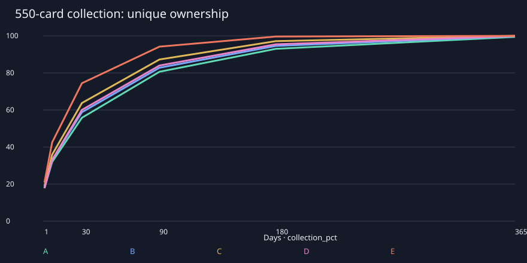
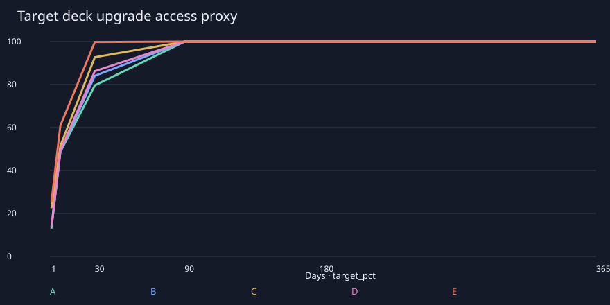

# Wirtschaftssimulation – vorläufige Alpha-Parameter

**Simuliert, nicht im Hauptspiel integriert.** Alle Wirtschaftswerte sind vorläufig. Synthetische IDs bilden 550 Karten ab; dieser Bericht behauptet weder 550 implementierte Kartenfähigkeiten noch gemessene Kampfstärke oder Umsatz.

## Reproduktion und Unsicherheit

`python3 tools/economy/simulate_progression.py` liest sämtliche Parameter aus `data/economy/*.json`. Python-Standardbibliothek; keine zusätzlichen Pakete. Seed 5502026; 200 unabhängige Trajektorien je Profil und Szenario, insgesamt 3000, zusätzlich 1000 Sensitivitätsläufe und 400 gepaarte Meilensteinläufe; 100,000 Booster für Raten/Pity. 
`target_completion.csv` verwendet Tag366 für bis Tag 365 unvollständige Decks; Mittelwert und Quantile sind dann rechtszensierte Kennzahlen. Bei den aktuellen Szenarien erreichen alle200 Trajektorien je Profil das vollständige Upgrade innerhalb365 Tagen.

CSV-Dateien enthalten Mittelwert, empirische P05/P95 und approximatives 95%-Konfidenzintervall des Mittelwerts. P05/P95 beschreiben Spielerstreuung, nicht Konfidenz. Normalintervalle binärer Erfolgswerte sind nur Näherungen; 200 Läufe lösen extreme 0,1%-Randfälle nicht auf. Der harte Pity-Grenzwert wird zusätzlich deterministisch getestet.

## Annahmen

- Kennzahlen:`total_cards_acquired` zählt Starterkopien, sämtliche Boosterfunde (einschließlich später umgewandelter Duplikate) und hergestellte Karten. `cards_received` zählt ausschließlich Booster-Rohzufluss; `playable_copies` zählt den aktuell nutzbaren Besitz nach Umwandlung. `starter_copies` und `crafted_cards` schlüsseln den restlichen Zufluss auf.
- Katalog: 250 gewöhnliche, 160 seltene, 100 epische, 40 legendäre Karten. Fraktionen sind Platzhalter; Seltenheit ist kein gemessener Stärkeparameter.
- Starterbesitz modelliert den aktuellen Adapter: 17 gewöhnliche IDs/51 Kopien, 20 seltene IDs/56 Kopien, 4 legendäre IDs/4 Kopien = 41 IDs/111 gebundene physische Kopien. Vier Decklisten à 30 teilen drei neutrale Kopien. Zielkarten sind zusätzliche IDs. Alle Zielkarten gehören derselben synthetischen Macht; Fraktionszugehörigkeit ist ein Ressourcenmodell, kein Nachweis einer legalen finalen550-Strategie.
- Jede zehnminütige Partie wird als gültig abgeschlossen modelliert. Tagesaufgabe: 1 Partie; optionale 10 gespielte Karten werden ab 2 Partien angenommen. Wochenaufgabe 10 Partien wird konservativ am siebten Tag ausgezahlt. Kein Sieg, täglicher Login oder absichtlich schlechter Spielzug erforderlich. Teilnahme/Questquoten sind Modellannahmen, keine Telemetrie.
- Kampagnenkapitel werden an Tagen 1/3/7/14/30 abgeschlossen; deren Spielzeit ist in den Partien enthalten. Keine Kampagnenschwierigkeit simuliert.
- Gold wird sofort für Standardbooster ausgegeben. Boosterbudgets D/E sind externe Modellparameter ohne Echtgeldbetrag und ohne implementierten Shop. Gleichmäßige monatliche Vergabe.
- Crafting: fehlende Ziellegende und zwei gezielte epische Schlüsselkarten zuerst, danach übrige seltene und epische Zielkopien. Keine manuelle Verwertung brauchbarer oder gebundener Karten; kein Sammlungsvollständigkeits-Crafting nach dem Zieldeck. Daher sind spätere Shardbestände eine bewusste konservative Senkenannahme.
- Zieldeckzugang ist ein Ressourcenproxy: 18 vorhandene Starterkopien + 8 seltene Kopien (4 IDs×2), 3 epische IDs×1, 1 legendäre ID. Vier Starterstrategien gelten als verfügbar; eine fünfte Strategie wird nur als Proxy nach vollständigen 12 Upgradekopien gezählt. Keine Decklegalitäts-, Siegquoten- oder Balancegarantie.
- Spielerlevel 5 und 10 gewähren jeweils 400 Herstellungsressource zusätzlich zu 50 Gold/50 XP. Diese einmaligen Meilensteine wurden anhand der Simulation ergänzt; Gold-/XP-Werte sonst gleich.
- Onboarding enthält 300 Gold, 5 Booster und 1200 Herstellungsressource; die Ziellegende kann direkt hergestellt werden. Alle Starter-Legenden bleiben zusätzlich gebunden. Preise sind reine Gold-Testwerte.
- Godot und Python verwenden verschiedene Zufallsgeneratoren. Die gleichen Datenregeln werden modelliert, keine bitidentische Folge behauptet. Die Simulation ist keine serverseitige Sicherheitsevidenz.

## Profile und Balanced-Ergebnisse

|Profil|Min/Tag|Extra-Booster/30 Tage|Tag 30 Booster|Tag 30 Sammlung|Tag 90 Sammlung|Tag 365 Sammlung|
|---|---:|---:|---:|---:|---:|---:|
|A|20|0|87.0|55.8%|80.7%|99.5%|
|B|45|0|96.0|58.8%|82.8%|99.8%|
|C|90|0|114.0|63.8%|87.2%|100.0%|
|D|45|4|100.0|60.0%|84.0%|99.9%|
|E|180|40|163.0|74.5%|94.2%|100.0%|

|Profil|Schlüsselkarten Tag 30 vollständig|12 Upgrades Tag 30 Mittel/P05|12 Upgrades vollständig Tag 30|Tag 365 spielbare Kopien|Tag 365 Legendäre Kopien|
|---|---:|---:|---:|---:|---:|
|A|100.0%|79.6% / 58.3%|7.0%|1514.3|40.0|
|B|100.0%|84.1% / 66.7%|12.0%|1544.8|40.0|
|C|100.0%|92.8% / 83.3%|32.5%|1568.8|40.0|
|D|100.0%|86.2% / 66.7%|18.0%|1558.6|40.0|
|E|100.0%|99.8% / 100.0%|97.5%|1570.0|40.0|

## Booster und Pity

Vier Basisslots: 80% gewöhnlich/17% selten/2,5% episch/0,5% legendär; ein garantierter Slot: 80% selten/18% episch/2% legendär. Die Basis-Chance auf mindestens eine Legende pro Booster ist `1−0,995⁴×0,98 =3,945%`. Pity ersetzt den letzten Slot bei Bedarf: spätestens Booster 5 episch oder höher, Booster 20 legendär. Legendär setzt beide Zähler zurück; Pity läuft über Sitzungen weiter.

Gemessen: 7.07% Booster mit Legende einschließlich Pity; mittlerer Abstand 14.14, P95 20.0, maximal 20; maximaler episch-oder-besser-Abstand 5. Basisslot-Raten und Konfidenzintervalle: `results/booster_rates.csv`. Pity verändert effektive Gesamtwahrscheinlichkeiten, nicht die veröffentlichten Basisslot-Chancen.

## Szenarienvergleich und Fairness

|Szenario|B Booster Tag 30|B Sammlung Tag 90|B Schlüsselkarten vollständig Tag 30|B: 12 Upgrades Tag 30|B: 12 Upgrades vollständig Tag 90|
|---|---:|---:|---:|---:|---:|
|friendly|114.0|86.8%|100.0%|99.6%|100.0%|
|balanced|96.0|82.8%|100.0%|84.1%|100.0%|
|restrictive|65.0|72.0%|13.0%|87.5%|29.5%|

Der zahlungs-/zeitbedingte B→E-Abstand an Tag 30 beträgt 15.7 Prozentpunkte einzigartige Sammlung. B und D unterscheiden sich nur im externen Boosterbudget; B und E zusätzlich in Spielzeit. Seltenheit kann stärkere Fähigkeiten bedeuten: größere Auswahl und frühere Upgrades bleiben ein Pay-to-win-Risiko. Ohne stabile Decks, Matchmaking und Kampfsimulation ist eine tatsächliche Überlegenheit nicht quantifizierbar.
Messbares vorläufiges Fairnessziel aus der Konfiguration: regelmäßige F2P-Spieler sollen bis Tag 30 eine gezielte Legende und zwei epische Karten erreichen. `key_access_complete` misst dieses Zugangsziel; `target_pct`/`target_complete` messen getrennt das anspruchsvollere vollständige 12-Kopien-Upgrade. Diese beiden Maße sind keine Wettbewerbsgarantie. Bewertung außerdem anhand der P05-Zielkopienquote. Ein hoher Mittelwert allein erfüllt dieses Ziel nicht. Vier Starter und eine gezielt herstellbare Legende begrenzen den Ausschluss, garantieren aber keine kompetitive Parität.

## Inflation, Erweiterung und Senken

|Profil|Tag 365 Gold erhalten|Gold ausgegeben|Goldbestand|Shardbestand|Duplikate|
|---|---:|---:|---:|---:|---:|
|A|64400|64400|0|25573|2396|
|B|72350|72300|50|30187|2760|
|C|91200|91200|0|44979|3681|
|D|72350|72300|50|33270|2986|
|E|94850|94800|50|90654|6290|

Geschlossene Ökonomie ohne Spielerhandel: Goldhortung ist Kaufkraftüberhang, keine Marktpreis-Inflation. Ausgeben hält Gold unter einem Boosterpreis; ein Sparer kann einen großen Bestand bilden. Herstellungsressourcen akkumulieren nach Erreichen des Zieldecks, weil das Modell weitere Crafts bewusst aussetzt. Eine echte Expansion/Handelsökonomie braucht serverseitige Bestands- und Senkenregeln; lokale Bestände dürfen keinen Marktwert bekommen.

Sensitivität für Profil B, Balanced (`results/sensitivity_summary.csv`): hypothetische 110-Karten-Erweiterung ab Tag 181 bei gleichen Slots/Preisen und gemeinsamem Pity; Goldhortung; alternative 40×3 gewöhnliche Starter; Onboarding ohne 1200 Herstellungsressource; Zugang ohne die neuen 400er-Meilensteine. Die Erweiterung senkt die Vollständigkeitsquote durch den größeren Nenner und verdünnt gezielte Ziehchancen. Bestehende Karten, Ressourcen und Pity werden nicht gelöscht.

|B Sensitivität|Tag 365 Goldbestand|Tag 365 Sammlung|Tag 365 Shards|Schlüsselkarten Tag 30 vollständig|
|---|---:|---:|---:|---:|
|expansion181|50|98.6%|26249|100.0%|
|hoard_gold|72350|64.1%|130|100.0%|
|common_only_starters|50|99.8%|28571|100.0%|
|no_welcome_crafting|50|99.8%|29418|18.0%|
|no_upgrade_milestones|50|99.8%|29719|7.0%|

Crafting-Senken sind strikt teurer als Verwertung: Kosten 40/100/400/1200, Erlös 5/20/80/240. Craft→Verwerten verliert mindestens 80% (gewöhnlich 87,5%); Starter und kosmetische Varianten erzeugen keine wiederholbaren Ressourcen. Goldquellen sind an einmalige Quellen-IDs, Tageslimits und Questperioden zu binden; der lokale Simulationsseed beweist keinen Manipulationsschutz.

## Optimierung gegenüber dem Ausgangsmodell

Eine gepaarte 200-Seed-Untersuchung für Profil B hielt Gold/Booster und die Priorisierung der drei Schlüsselkarten konstant. Ohne 400er-Craftingmeilensteine erreichten 2.0% die drei Schlüsselkarten bis Tag 7 und 7.0% bis Tag 30; mit 400 Ressource auf Level 5 und 10 erreichten 100.0% diese Ziele bereits bis Tag 7. Die vollständigen 12 Upgrades stiegen an Tag 30 von 0.0% auf 9.0%; durchschnittliche Kopienabdeckung von 70.0% auf 83.5%. Quelle: `results/milestone_comparison.csv`. Deshalb wurden die beiden einmaligen Ressourcenmeilensteine in die vorläufige Konfiguration aufgenommen.

Das frühere Ausgangsmodell mit Legende→selten→episch-Priorität ist vollständig als `baseline_config.json`, `baseline_progression_summary.csv` und `baseline_metadata.json` erhalten. Reproduktion ohne Überschreiben der finalen CSVs: `python3 tools/economy/simulate_progression.py --config-snapshot docs/economy/results/baseline_config.json --output-dir /tmp/orafold-baseline`. Der Bericht enthält die finalen Werte; der archivierte Baseline-CSV beschreibt die ältere Craftingpriorität und einen ursprünglichen, fraktionsgemischten Ressourcenwarenkorb gleicher Seltenheitsverteilung. Die finale Zielauswahl verwendet eine Macht. `no_upgrade_milestones` isoliert dagegen die Ressourcenänderung unter gleicher finaler Priorität.

Die Verbesserung ist ein gezielter kostenloser Zugangspfad und keine beliebige Freischaltung aller Strategien. Dass innerhalb eines Jahres viele Sammlungen beinahe vollständig werden und große Shardbestände entstehen, begrenzt ein Geschäftsmodell mit ausschließlich Sammlungsbeschleunigung. Neue Erweiterungen und optionale Kosmetik sind zu prüfen; künstliche Ressourcenlöschung oder verpflichtender Grind sind daraus nicht abzuleiten.

## Grenzen und nächste Entscheidungen

- Die endgültigen 550 IDs, Fraktionsverteilung, Seltenheiten und Starterqualität sind externe Integrationsabhängigkeiten. Der heutige Alpha-Katalog enthält keine epischen Karten; der synthetische Pool wird ausdrücklich als Testdatensatz verwendet.
- Aktuelles Modell setzt tägliche Teilnahme voraus. Fehlende Wochen/Tage kosten nur ausbleibende Belohnung; es gibt keine Verluststrafe oder Loginserie. Retention und Frust müssen mit realer Telemetrie validiert werden.
- Keine Verkaufspreise, Erlösprognosen, Käufe, Handel oder produktive Servertransaktionen implementiert. Wirtschaftliche Tragfähigkeit kann aus Packbudgets allein nicht abgeleitet werden.
- Deckzugang, Kampfstärke und Vielfalt brauchen stabile Katalog-/Kampfschnittstellen. Kosmetikfinanzierung, Ranked-Normalisierung und garantierte wettbewerbsfähige Deckpfade bleiben Produktentscheidungen.
- Vollständige Checkpoints 1/7/30/90/180/365 mit Gold, Packs, Karten, Seltenheiten, Crafting, Kopien, Sammlung und Strategieproxies sind in den CSV-Dateien enthalten; Konfidenzintervalle und Seeds ermöglichen Wiederholung.
