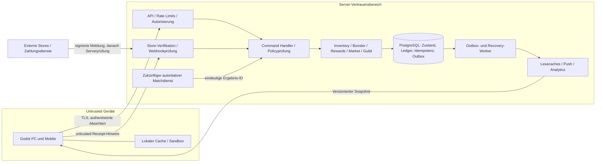

# Serverautorität und Systemarchitektur

## Architekturentscheidung A-01: zuerst eine ACID-Schreibgrenze

Vorschlag: modularer Backend-Monolith mit PostgreSQL, nicht früh getrennte Wallet-/Inventar-/Handels-Schreibdatenbanken. Fachmodule Catalog, Inventory, Rewards, Booster, Ledger, Market, Guild und Access besitzen eindeutige Verantwortlichkeiten, teilen aber die Transaktion für Vermögen. Auslagerung von Lesemodellen/Benachrichtigungen über Outbox; kein verteiltes Zwei-Phasen-Commit als MVP-Voraussetzung.

Zukünftige Authentisierung bindet Nutzerkennung und Realm. Service-DB-Zugänge haben eng begrenzte Rechte; Supportaktionen benutzen dieselben auditierten Commands. Kein direkt schreibender Client oder WebSocket-Handler außerhalb der Anwendungstransaktion. Produktionssprache/Hosting/Identityanbieter noch offen; Godot bleibt Präsentation, Eingabe und nicht autoritativer Cache.

Store und Matchdienst sind getrennte Vertrauensgrenzen: eine Client-Siegmeldung oder ein Clientreceipt sind keine gültigen Rewardnachweise. Storeverifikation erfordert serverseitige Produkt-/App-/Umgebungs-/Kontobindungsprüfung. Der Matchdienst ist **noch nicht vorhanden**; vor ihm nur Sandboxbelohnungen oder ausdrücklich serververifizierbare begrenzte Tutorialaktionen.

## API- und Adapterverträge

Zukünftige fachliche Ports, keine implementierten Klassen:

| Port | Commands / Queries | Fachliche Grenze |
|---|---|---|
| CatalogPort | GetManifest, GetDefinitions | Immutable Revisionen, keine Besitzmutation |
| InventoryPort | GetInventory(cursor), GetChanges(version) | Nur serverbestätigte Zeilen; Snapshotcursor verhindert fehlende/doppelte Seiten bei Paralleländerung |
| EconomyPort | ClaimReward, OpenPack, SalvageCard | Eindeutige Quellen, Idempotenz, atomare Vermögenswirkung |
| DeckModePort | SaveDeck, ValidateDeck, RequestMatchTicket | Schema-/Modus-/Pool-/Besitz-/Entitlementprüfung erneut auf Server |
| MarketPort | CreateSell/CreateBuy, AcceptListing, CancelListing | Escrow, Gebühren, Sperren; keine freien Clienttransfers |
| GuildPort | Join/Leave, ChangeRole, Donate, ClaimGuildReward | Rechte beim Commit prüfen, Kassenledger wie Nutzerledger |
| EntitlementPort | QueryAccess, RequestEntry | Permanente, zeitliche und Leihrechte getrennt |
| PurchasePort | SubmitReceiptHint, QueryPurchaseState | Serverprüfung; Netzwerk-I/O außerhalb DB-Transaktion, atomarer bestätigter Grant danach |

Requestfelder: `client_command_id`, `idempotency_key`, `expected_version` für veränderliche Aggregate, `payload`; Identität aus Token, nicht owner_id im Body. Für fremde Ressourcen Rollen/Ownership prüfen. Response: `operation_id`, `status`, autoritative Delta-/Snapshotreferenzen und `new_versions`, keine stillen Teiländerungen. Fehlercodes u.a. `VERSION_CONFLICT`, `POLICY_RETIRED`, `INSUFFICIENT_FUNDS`, `ITEM_LOCKED`, `ALREADY_CONSUMED`, `ACCESS_EXPIRED`, `IDEMPOTENCY_MISMATCH`. 409 liefert Refreshhinweis; 202 nur für dauerhaft erfasste noch nicht abgeschlossene Verifikationsoperation, niemals vorgetäuschten Besitz.

Lesecache mit `inventory_version`, `catalog_manifest_ref`, `as_of`. Push dient Invalidierung, nicht Buchung. Geht eine Nachricht verloren, Delta oder Vollsnapshot ziehen. Mehrgeräte-Schreibkonflikte durch CAS/DB-Locks lösen; nicht durch clientseitiges Addieren beider Bestände. Kein Last-write-wins für Vermögen.

## Lokale Simulation und Austauschbarkeit

Phase B–D: LocalEconomyAdapter implementiert dieselben Ports mit lokaler transaktionaler Speicherung (z.B. SQLite, Plugin-/Plattformtauglichkeit erst evaluieren). Tests injizieren Uhr/RNG/Storestub/Fehler. `realm:sandbox`, simulierte Principal-ID und deutlich als simuliert markierte UI; keine echten Kaufprodukte. Simulator arbeitet atomar und prüft Invarianten, aber ist gegenüber Gerätebesitzern nicht sicher.

Phase E: RemoteEconomyAdapter ersetzt Implementierung, nicht Card-/Deck-/Policyverträge. Clientcache darf unsichere lokale Commands **nicht automatisch** in Echtgeld-/Marktvorgänge übersetzen. Ausstehende Sandboxcommands bleiben Sandbox; produktive Timeoutretries verwenden nur ihren ursprünglichen Live-Key. Serverzeit und CSPRNG ersetzen Simulatoruhr/RNG; Clients liefern keine verbindlichen Zufallsergebnisse.

Offline-Live-Modus: gecachter Besitz kann lokales Üben erlauben, aber weder kompetitive Freigabe, gültigen Verkauf noch wirtschaftlichen Gewinn erzeugen. Bei Wiederverbindung neue Authentisierung und Snapshot. Lokaler `progress_v1` bleibt Komfortstand; Serverinventar startet aus eigener verifizierter Quelle. Eine spätere Kulanzübernahme ist begrenzte Serverkampagne, keine Importfunktion für lokale Zahlen.

## Versionen, Betrieb und Wiederherstellung

Catalog-/Mode-/Boosterpolicyrevisionen immutable veröffentlichen; kompatible Clients bekommen Manifest, Hash und Mindestclientversion. Ein Rulesetwechsel ist kein Update einer CardInstance gegen Geld. Unbekannte Capability fail-closed, sichere Übungs-/Infoseite statt falscher Kampfberechnung.

Monitoring: Buchungsinvarianten, Commit-/Konfliktraten, offene Escrows, Storeverifikationsalter, Outbox-Lag und Reconciliationabweichungen. Kill-Switches pro Economycommand/Pool/Region erlauben Lesen und laufende sichere Abwicklung, ohne bereits committed Grants zu löschen. Backup/PITR, Restoreproben und providerbasierte Kaufreconciliation vor Phase F; Outbox nach Restore dedupliziert erneut senden. Keine Aussage über belastbare Kapazität/Latenz ohne Messung. SLOs und Recoveryziele sind offene Betriebsentscheidungen.
