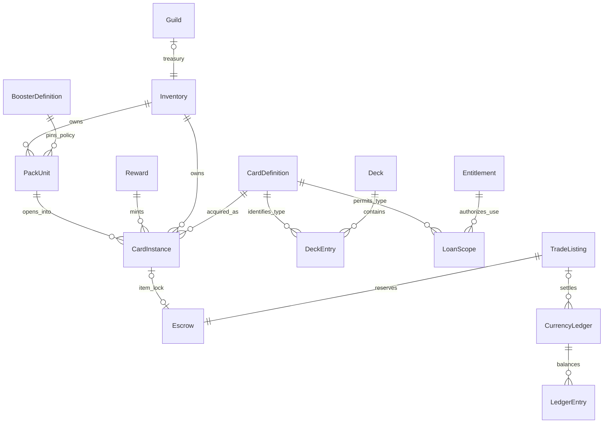

# Versionierte Datenverträge

**Alle folgenden Modelle sind Entwürfe.** Die JSON-Blöcke sind vollständige illustrative Datensätze für den beschriebenen fachlichen Ausschnitt, keine implementierten API- oder DB-Schemas. Ergänzende Transport-/Diensttabellen (Operation, PackUnit, MatchTicket, OwnershipEvent, Outbox) stehen in den Transaktionsdokumenten.

## Gemeinsame Regeln

- `schema_version:uint16` beschreibt das Speicher-/Transportformat. `version:int64≥0` ist die optimistische Aggregatrevision (im JSON Dezimalstring). Definitionen/Policies haben getrennte unveränderliche Inhaltsrevisionen. API major unter `/v1`; unbekannte Pflichtfelder/Enumwerte ablehnen, additive optionale Felder tolerant lesen.
- Öffentliche Asset-/Transaktions-/Principal-IDs: servergenerierte UUIDs. Kurze Zeichenketten in Beispielen wie `u_alice` sind **symbolische Dokumentations-IDs**, keine echten UUIDs. Bestehende `card_id` wie `ash-0` bleiben unverändert, eindeutig innerhalb `catalog_id`.
- Beträge, große Zähler und Versionen als kanonische Dezimalstrings; Versionen/Zähler fachlich auf 0 bis 2^63−1 begrenzt, DB signed BIGINT mit Limits, geprüfte Addition und keine Floats. Basispreise/Bestände nichtnegativ; Ledgerdeltas vorzeichenbehaftet. Beispiele kleiner Werte sind keine Produktentscheidung. Kleine Kartenwerte/Anzahlen als begrenzte JSON-Integer.
- Zeit: UTC RFC3339, Serveruhr; null explizit unbefristet. Definition-/Policy-Hashes: SHA-256 über kompaktes UTF-8-JSON mit rekursiv lexikografisch sortierten Stringschlüsseln, unveränderter Arrayreihenfolge und begrenzten Integerwerten; content_hash/policy_hash, Signaturen und veränderlicher Publikationsstatus sind vom Hashpayload ausgeschlossen. Freie Floatwerte sind in diesen signierten Policy-/Definitionspayloads verboten; Texte unverändert, kein stilles Unicode-Normalisieren. Signaturen binden Hash und Namespace/Revision separat. Hash ist kein Eigentumsnachweis.
- DB-FKs und Unique-Constraints sichern Beziehungen; keine Besitzlisten als gleichzeitig schreibbare zweite Wahrheit. Snapshots/Lesecaches sind Projektionen. `realm` = `sandbox` oder `live`, systemweit isoliert.
- Migration: expand/backfill/validate/contract, keine destruktive Umdeutung. Upcaster pro Schema, dual-read begrenzt, Backfill idempotent und checkpointed. Alte Definitionen/Policies für Audit/Matches behalten; keine existierende Karte stillschweigend umnummerieren. Finanzeinträge durch Gegenbuchung, nicht Rewrite korrigieren.

## 1. CardDefinition

| Attribut / Typ | Vertrag |
|---|---|
| catalog_id:string, card_id:string, definition_version:uint32 | Zusammengesetzte unveränderliche Identität; Original-ID behalten |
| name_key:string, ruleset_id:string | Anzeige unabhängig von Identität; ausführbarer Effektkatalog außerhalb der Ökonomie |
| kind:enum, rarity_id:string, order_id:string | Kreaturtyp und Klassifikation; Seltenheit ist kein Kaufpreis |
| rules:object | Begrenzte Integer für energy_cost/attack/hp und whitelisted effect_id/power; kein frei ausführbarer Code |
| content_hash:string, status:enum | draft/published/retired; Hash muss Inhalt decken, published-Inhalt unveränderlich, Publikationsstatus getrennt |

Beziehung: Instanz referenziert Erwerbsdefinition; Modi resolvieren dieselbe genehmigte Spielrevision für alle Kopien. Neue Balanceversion verändert weder Besitzer noch Instanzstärke kaufabhängig. Lebenszyklus: draft → published → retired (kein neuer Drop, bestehende Exemplare nicht löschen); nur der getrennte Publikationsstatus darf wechseln, nicht der publizierte Inhalt. Persistenz: immutable Katalogtabellen + versioniertes Manifest/Clientcache. Migration: alte JS-Felder `cost/atk/hp/order/effect/power` explizit auf DTO-Felder mappen ohne Werteänderung. Das Beispiel `ash-0` ist 2 Energie / 1 ATK / 4 HP / strike power2 wie in JS, nicht die heutige Aschenwache.

```json
{"schema_version":1,"catalog_id":"legacy-34b3062","card_id":"ash-0","definition_version":1,"name_key":"legacy.cards.ash-0.name","ruleset_id":"legacy-v1-proposed","kind":"creature","rarity_id":"common","order_id":"ash","rules":{"energy_cost":2,"attack":1,"hp":4,"effects":[{"effect_id":"strike","power":2}]},"content_hash":"sha256:895dde8bad85f94b2f67bad2fcd8f313cd5ea2b67efd5bd3b003c53d26832f8b","status":"published"}
```

## 2. CardInstance

| Attribut / Typ | Vertrag |
|---|---|
| instance_id:UUID, owner_inventory_id:UUID, realm:enum | Genau ein Besitzer, nie vom Client gewählt |
| definition_ref:object | catalog_id/card_id/definition_version beim Erwerb, nicht veränderliche Besitzstatistik |
| origin:object | grant_id/pack_unit_id/transaction_id und Policyrevision; Chargeback-Provenienz |
| state:enum | available/escrow/match_locked/quarantined/consumed; terminaler Zustand bleibt auditierbar |
| binding:object | unbound/account_bound/guild_bound mit reason/policy_ref; optional trade_after UTC |
| acquired_at:timestamp, version:int64≥0 | CAS für konkurrierende Nutzung; keine ATK-/HP-Upgrades pro Kauf |

Beziehungen: FK Inventar, Definition, Ursprung; Sperren referenzieren MatchTicket oder Listing. Zulässig handeln nur unbound, available, trade_after erreicht, nicht gesperrt; bei regulärem Booster Default unbound. Lebenszyklus: Mint available → Lock → available/Ownerwechsel; salvage → consumed; Quarantäne nur Risikopolicy. Persistenz: aktuelle Zeile + append-only OwnershipEvents. Migration: Kopien nur aus geprüfter Quelle minten, niemals aus lokal gemeldeten Anzahlen. Versionswechsel der Spielregeln ist kein Neumint.

```json
{"schema_version":1,"instance_id":"ci_001","realm":"live","owner_inventory_id":"inv_alice","definition_ref":{"catalog_id":"legacy-34b3062","card_id":"ash-0","definition_version":1},"origin":{"grant_id":"grant_001","pack_unit_id":"pack_001","policy_ref":"booster-standard@1"},"state":"available","binding":{"kind":"unbound","reason":null,"trade_after":null},"acquired_at":"2026-11-09T14:00:00Z","version":"1"}
```

## 3. Inventory

| Attribut / Typ | Vertrag |
|---|---|
| inventory_id:UUID, principal:{kind,id}, realm:enum | UNIQUE(realm,principal_kind,principal_id); Nutzer oder Gilde |
| version:int64≥0, status:enum | active/frozen/closed; Version steigt einmal je betroffenem Commit |
| card_count:int64≥0, updated_at:timestamp | Nur Serverprojektion; Instanzzeilen sind Besitzwahrheit |

Keine konkurrierende autoritative `instances[]`-Liste. Paginierte Query nach owner_inventory_id und konsistentem Snapshotcursor; Entitlements separat. Lebenszyklus active ↔ frozen → closed nach bereinigtem Vermögen/Aufbewahrung. Persistenz: Aggregateheader relational, Projektionen rekonstruierbar. Migration: neue Schemas per Backfill; Quelle/Realm niemals aus Clientimport ableiten. Schließen löscht keine Audit-/Ledgerhistorie.

```json
{"schema_version":1,"inventory_id":"inv_alice","principal":{"kind":"user","id":"u_alice"},"realm":"live","version":"7","status":"active","card_count":"25","updated_at":"2026-11-09T14:00:00Z"}
```

## 4. Deck

| Attribut / Typ | Vertrag |
|---|---|
| deck_id:UUID, owner_id:UUID, version:int64≥0 | Serverpersistiertes Nutzeraggregat; Name kein Schlüssel |
| mode_manifest_ref:string, entries:array | Definition-IDs + counts:uint16; optional konkret reservierte instance_ids erst im MatchTicket |
| display_name:string, status:enum | Nutzertext begrenzen/escapen; draft/valid/invalid/archived |

Validierung: Pool/Revision, Deckgröße/Kopienregel, aktuelle nutzbare Besitzkopien **oder** scoped Entitlement; letzteres nicht als Besitz zählen. Kopien können in mehreren gespeicherten Decks vorkommen, sind aber beim Wettkampfstart eindeutig auszuwählen/zu sperren. `valid` ist Cache, keine Eintrittsgarantie. Lebenszyklus draft → valid/invalid; Verkauf/Rotation kann revalidieren; archived weiter lesbar. Persistenz: Header/Entryzeilen; Match speichert unveränderlichen Decksnapshot. Migration: Modewechsel ist neue Validierung; keine stillschweigende Index-/Namenszuordnung. Der folgende Eintrag ist ein Draftausschnitt, kein behauptetes gültiges 25er-Deck.

```json
{"schema_version":1,"deck_id":"deck_001","owner_id":"u_alice","version":"2","display_name":"Mein Entwurf","mode_manifest_ref":"classic-legacy@1","status":"draft","entries":[{"catalog_id":"legacy-34b3062","card_id":"ash-0","count":1}]}
```

## 5. BoosterDefinition

| Attribut / Typ | Vertrag |
|---|---|
| booster_id:string, revision:uint32, policy_hash:string | Immutable veröffentlichte Ziehpolicy |
| pool_ref:string, slots:array, rarity_weights_bps:object | Revisionierter Pool und Ziehreihenfolge; Gewichte exakt 10000, nie Floating-Point |
| guarantee/duplicate/pity/binding:object | Vollständige auflösbare Policies, keine versteckten Defaults nach Veröffentlichung |
| availability:object, status:enum | UTC Zeitraum, Regionen/Produkte getrennt; draft/published/retired |

Konfigurationscompiler prüft jeden möglichen Slot-/Pity-Zweig auf nichtleeren Pool. Boosterexemplar (`PackUnit`) hat eigene UUID, owner/state und fixierte policy_ref; seine Öffnung verändert nicht die Definition. Persistenz immutable Policy, Produktangebot separat. Migration: veröffentlichte Revision behalten; vorhandene Packs behalten ihre Policy, außer ausdrücklich akzeptierter, protokollierter Ersatz/Erstattung. Konkretes Beispiel samt Algorithmus in [booster-rules.md](booster-rules.md).

```json
{"schema_version":1,"booster_id":"standard","revision":1,"policy_hash":"sha256:e78fb008578fac26ed3282c6c45e506e5fc60fadb740222d954330ee8d95fd9a","pool_ref":"legacy-test@1","slots":[{"count":2,"minimum_rarity":"common"},{"count":1,"minimum_rarity":"rare"}],"rarity_weights_bps":{"common":7000,"rare":2400,"epic":500,"legendary":100},"guarantee":{"scope":"pack","minimum":"rare","count":1},"duplicate_policy_ref":"lifetime-soft@1","pity_policy_ref":"standard-pity@1","binding":{"default":"unbound","exceptions":[]},"availability":{"starts_at":null,"ends_at":null},"status":"draft"}
```

## 6. Reward

| Attribut / Typ | Vertrag |
|---|---|
| reward_id:UUID, beneficiary_id:UUID, source:{kind,id,period} | UNIQUE(realm,beneficiary,source-kind,source-id,period) gegen wiederholtes Claim mit neuen Keys |
| reward_policy_ref:string, lines:array | Explizite card/pack/currency/entitlement-Mengen, Policies und Bindung |
| state:enum, transaction_id:UUID?, granted_at:timestamp? | pending/granted/rejected/compensated; nur Serverquelle darf pending erzeugen |

Validierung: serverbestätigter Tutorialcheckpoint/Match/Quest, Caps, Realm, keine ungesicherten Client-Siegwerte. Alle Zeilen einer Vergabe atomar. Tutorialgrant liefert vollständige versionierte START-Multimenge, nicht einen zufälligen Ersatz. Persistenz relationaler Grant + GrantLines + Outbox, keine Löschung bei Wiederholung. Migration: Source-Unique bleibt über Schemawechsel; Kompensation hat eigene Referenz, Historie bleibt.

```json
{"schema_version":1,"reward_id":"reward_tutorial_001","beneficiary_id":"u_alice","realm":"live","source":{"kind":"tutorial_complete","id":"tutorial-v1","period":"once"},"reward_policy_ref":"starter-complete@1","lines":[{"kind":"deck_bundle","bundle_ref":"legacy-start@1","binding":"account_bound"}],"state":"granted","transaction_id":"tx_tutorial_001","granted_at":"2026-11-09T14:00:00Z"}
```

`deck_bundle` muss vor Commit in alle 25 Instanzen aufgelöst und mengen-/poolgeprüft werden; keine teilweise Startervergabe. Accountbindung hier ist ein **expliziter Vorschlag nur für Gratisstarter**, keine Booster-Ausnahme und noch keine Produktfreigabe.

## 7. CurrencyLedger

| Attribut / Typ | Vertrag |
|---|---|
| transaction_id:UUID, entries:[{entry_id,account_id,delta}] | Append-only Double-Entry-Gruppe; UNIQUE(entry_id), Summe je currency=0 |
| currency_id:string, realm:enum, reason:string | `trade_gold` nicht gegen Echtgeld auszahlbar; Energie ist keine Währung |
| business_ref:string, committed_at:timestamp | UNIQUE fachlicher Vorgang; erlaubte begrenzte Systemkonten mint/burn/fee |

Jede Buchung DB-BIGINT-geprüft, keine negativen Nutzerkonten, Ledgerzeilen nicht UPDATE/DELETE. Walletsaldo ist unter Sperre aktualisierte Projektion; reconcile gegen Ledger. Reserven sind eigene Subkonten. Lebenszyklus nur committed; Korrektur durch Gegenbuchung mit eigener UUID/original_ref. Persistenz partitionierte relationale Einträge + unveränderliche Auditkopie; Aufbewahrung/Personenbezug gesondert regeln. Migration: neue Einträge/Adapter, niemals Währung mit anderem Wert unter derselben ID umdeuten.

```json
{"schema_version":1,"transaction_id":"tx_gold_001","realm":"live","currency_id":"trade_gold","reason":"verified_reward","business_ref":"reward:reward_gold_001","committed_at":"2026-11-09T14:00:00Z","entries":[{"entry_id":"le_001","account_id":"system:reward_source","delta":"-100"},{"entry_id":"le_002","account_id":"wallet:u_alice:available","delta":"100"}]}
```

## 8. TradeListing

| Attribut / Typ | Vertrag |
|---|---|
| listing_id:UUID, owner_id:UUID, side:enum, version:int64≥0 | sell/buy, authentisiert; ein Exemplar je Angebot im ersten Entwurf |
| item_selector:object, escrow_ref:UUID | sell: konkrete instance_id; buy: catalog/card-ID und gewünschte Policy; keine Leihkarte |
| quote:{currency_id,price,fee_policy_ref}, expires_at | Ganzzahlige Preise, Server-Preisgrenzen, eingefrorene Gebührenrevision |
| state:enum, settlement_id:UUID? | open → filled/cancelled/expired; Quarantäne als expliziter Sonderfall |

Sell reserviert Karte, Buy reserviert Gold inkl. maximaler Käufergebühr. Zustand/Preis/Escrow atomar angelegt; open ohne Deckung verboten. Teilfüllungen im ersten Modell nicht erlaubt. Persistenz Header/Escrow/Fills, FK/Unique verhindern Doppelfüllung. Migration: alte Gebühren-/Bindungsregeln im Listing erhalten, nicht rückwirkend neue Gebühren verrechnen. Beispiel verkauft bereits gesperrte Instanz, nicht die gleichzeitig available-Beispielzeile oben; eigenständiger Beispielsnapshot.

```json
{"schema_version":1,"listing_id":"listing_001","owner_id":"u_alice","side":"sell","version":"1","item_selector":{"instance_id":"ci_001"},"escrow_ref":"escrow_001","quote":{"currency_id":"trade_gold","price":"100","fee_policy_ref":"seller-five-percent-test@1"},"expires_at":"2026-11-10T14:00:00Z","state":"open","settlement_id":null}
```

## 9. Guild

| Attribut / Typ | Vertrag |
|---|---|
| guild_id:UUID, version:int64≥0, status:enum | forming/active/frozen/dissolving/closed |
| display_name:string, role_policy_ref:string | Moderierter Text, versionierte Rechte |
| treasury_inventory_id:UUID, treasury_account_id:string | Separates Gildenvermögen, nicht Eigentum des Leiters |
| membership_version:int64≥0 | Mitgliedschaft in eigenen Zeilen: guild/user/role/joined_at/eligibility_at; pro Regel max eine aktive Gilde |

Rollen owner/admin/treasurer/member, least privilege; letzter Owner darf nicht ohne Nachfolge gehen. Entnahmen an Privatkonten zunächst verboten; spätere Zulassung verlangt Limits/Mehrfachfreigabe. Rewards gelten pro berechtigtem Mitglied/Ereignis, nicht pro wiederholtem Beitritt. Persistenz Guild/Membership/RoleGrant/Approval/Audit; Kasse benutzt denselben Ledger. Migration: Rechtewechsel explizit versionieren, Mitgliedschaften nicht aus UI-Rollenstrings vertrauen. Auflösung braucht Vermögens-/Offenangebotssperren und definierte Verteilung, kein implizites Leader-Cashout.

```json
{"schema_version":1,"guild_id":"guild_001","version":"4","status":"active","display_name":"Beispielgilde","role_policy_ref":"guild-basic@1","treasury_inventory_id":"inv_guild_001","treasury_account_id":"wallet:guild_001:available","membership_version":"9"}
```

## 10. Entitlement

| Attribut / Typ | Vertrag |
|---|---|
| entitlement_id:UUID, beneficiary_id:UUID, source_ref:string | Einmalige verifizierte Vergabe; nicht automatisch ein gekauftes Recht |
| kind:enum, scope:object, permissions:string[] | mode_unlock/event_access/card_loan; permanente Zugänge getrennt von zeitlichen Nutzungen |
| valid_from, expires_at:timestamp?, state:enum, version:int64≥0 | scheduled/active/expired/revoked; Serverzeit entscheidet, Cachejob ist nicht Autorität |

CardLoan enthält Definition-/Poolreferenzen und Nutzungsmodus, niemals Eigentumsinstanzen. Nur `play` erlaubt, keine sale/trade/salvage-Permission. Dauerhafter Gewinn aus Leihe benötigt separate Reward-Minttransaktion; kein Umflaggen geliehener Assets. Spielbeginn prüft Gültigkeit; gültiges Ticket darf bis serverseitigem Matchende weiterlaufen, nach Ablauf keine neuen Tickets. Persistenz Entitlement/Scope und append-only Grant/RevocationEvents. Migration: erneuerte Zeitrechte als neue Revision mit Ursache, revoked nicht durch Clientcache reaktivierbar.

```json
{"schema_version":1,"entitlement_id":"ent_loan_001","beneficiary_id":"u_alice","source_ref":"event:sealed-test-01","kind":"card_loan","scope":{"mode_manifest_ref":"sealed-test@1","pool_ref":"sealed-entry:u_alice:001"},"permissions":["play"],"valid_from":"2026-11-09T14:00:00Z","expires_at":"2026-11-10T14:00:00Z","state":"active","version":"1"}
```

## Beziehungen



Das Escrowdiagramm zeigt aktive Itemreservierungen; historische abgeschlossene Escrows werden getrennt aufbewahrt und unterliegen nicht der aktiven 0..1-Kardinalität.

Präzisierung: Modell `CurrencyLedger` beschreibt eine Transaktionsgruppe. DeckEntry/CardDefinition referenziert den stabilen Kartentyp; die konkrete Spielrevision kommt aus dem Modusmanifest. Eigentümerschaft von Entitlement/Deck/Reward ist jeweils FK auf zukünftigen Principal, keine zusätzliche Inventarautorität.
