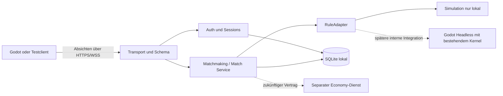

# Online-Systementwurf

Status: lokaler Infrastrukturprototyp. Zwei Accounts können einen simulierten
Matchablauf durchlaufen. **Kein spielbarer ORAFOLD-Onlinekampf, keine
Produktionsfreigabe und keine wirtschaftlichen Funktionen.**

## Entscheidungsmatrix

Bewertung relativ zum vorhandenen Godot-Projekt; qualitative Einschätzung,
keine gemessenen Leistungswerte. Kosten meinen Betriebs-/Wartungsaufwand.

| Option | Entwicklung | Kosten | Sicherheit/Wartung | Leistung/Skalierung | Godot/Web/Testbarkeit | Entscheidung |
|---|---|---|---|---|---|---|
| Node 24 + TypeScript | Schnell für HTTP/Auth/Schemas; Node im Projekt vorhanden | Kleiner einzelner Prozess möglich | Typen plus Runtimevalidierung; Dependencies pinnen und prüfen | Eventloop gut für I/O; CPU-Regeln später isolieren | JSON/HTTPS/WebSocket überall; automatisierte Mehrclienttests | **API-/Matchverwaltung im modularen Monolithen** |
| Go | Gute Standardbibliothek; zusätzlicher Stack | Kleine native Prozesse | Gute Wartbarkeit; Auth/SQL-Verträge dennoch selbst bauen | Gute Parallelität; keine Regelparität geschenkt | Godot über JSON/WSS; gute Tests | Alternative bei belegtem Bedarf, jetzt kein Zusatzstack |
| Godot Headless | Wiederverwendet tatsächliche Regellogik | Workerbedarf erst messen | Kleiner interner IPC-Vertrag; kein öffentlicher Godot-RPC-Zugriff | Pro Match/Workerpool zu messen | Beste Regelparität; vorhandene Headlesstests | **Bevorzugte spätere Regellaufzeit**, noch nicht verbunden |
| SQLite | Sehr einfacher lokaler Start, ACID, Fremdschlüssel | Keine zweite Maschine | Dateirechte/Backups nötig; synchroner Zugriff blockiert | Ein Writer, kein gemeinsames Netzwerkdateisystem | Node `node:sqlite`; echte DB-Tests | **Lokaler persistenter Prototyp** |
| PostgreSQL | Zusätzliche Installation/SQL-Portierung | VPS selbst gehostet oder Managed | Rollen, Backups/PITR und Migrationen etablierbar | Mehrere APIprozesse, Transaktionen/Locks | Treiber-/Isolationstests erforderlich | Produktionsziel, **kein implementierter Treiber** |
| Redis | Zusätzlicher Dienst und Konsistenzgrenzen | RAM/Betreuung zusätzlich | Keine Quelle für Besitz/Resultate | Sinnvoll für verteilte Limits/Queue/Presence | Gut testbar, aber jetzt unnötig | Zunächst weglassen |
| WebSocket über TLS | Einfacher bidirektionaler Transport | Wenig Overhead | Originprüfung/Auth/Größenlimit/Backpressure erforderlich | Langlebige Verbindungen; Routing später nötig | Browser inklusive WebKit und Godot kompatibel | `ws`; lokal HTTP/WS nur Loopback |
| Docker Compose | Reproduzierbare lokale API + Volume | Kostenlos lokal | Non-root-Container, Hostbindung, gepinnte Builds prüfen | Kein Scheduler/HA | Ergänzt direkten npm-Start | Lokaler Start, kein öffentlicher Rollout |

Keine Neuimplementierung der Kampfregeln in TypeScript. Der Simulationsadapter
enthält nur Transport-/Zustandsfortschrittsfixtures und wird nie als Regelkern
freigeschaltet.

Direkte Abhängigkeiten sind in `server/package-lock.json` gepinnt. Der geprüfte
Paketstand deklariert MIT für `argon2` 0.44.0, `ws` 8.22.2, `zod` 4.6.7,
`tsx` 4.20.6 und die verwendeten `@types`-Pakete; TypeScript 5.9.3 deklariert
Apache-2.0. Transitive/native Bestandteile und Node-/Containerlizenzen müssen bei
Distribution ebenfalls mit ihren tatsächlichen Notices berücksichtigt werden.
Diese Auswahl ändert die vorbehaltenen Rechte an ORAFOLD-Quellen/Assets nicht.
Die zunächst untersuchten älteren `ws`-/`zod`-Versionen wurden nach gefundenen
Advisories aktualisiert. Maßgeblich für Sicherheitsprüfung und Auflösung bleibt
die tatsächlich getestete Lockdatei; aktuelles Auditresultat siehe [QA.md](QA.md).

## Komponenten und Vertrauensgrenzen

Clients kontrollieren keine Ressourcen, Zufallswerte, Sieger, Ratingänderungen
oder Eigentumsnachweise. Auth leitet die Spieler-ID aus einer widerrufbaren
Session ab. Der Transport akzeptiert nur bekannte Protokollfelder. Der Matchservice
prüft Teilnahme, Status, Sequenz und Idempotenz, ruft den Adapter auf und persistiert
Zustand/Ereignis vor einer erfolgreichen Antwort. Versandfehler rollen keine
bereits bestätigte Aktion zurück; Reconnect holt den gespeicherten Stand.

Während laufender Matches bleiben Rohzustände, Startseed und interne Replaydaten
serverseitig. Vollständige abgeschlossene Simulationsreplays sind nur den beiden
Teilnehmern zugänglich. Jede laufende Zustandsübertragung entsteht aus der
expliziten Spieleransicht. Öffentliche Accountdaten
enthalten keine Login-, Passwort- oder Sessioninformationen.

## Daten und Konsistenz

SQLite wird mit Fremdschlüsseln und Transaktionen verwendet; Migrationen liegen
unter `server/migrations/`. Der Datenbankcode definiert den tatsächlich
implementierten Tabellenstand. Accounts/Sessions/Profiles sind von Matchzuständen,
Ereignissen und Idempotenznachweisen getrennt. Eindeutige IDs/Constraints begrenzen
logische Duplikate; SQL-Werte werden über Parameter gebunden.

Lokale Saves werden weder hochgeladen noch als Kartenbesitz importiert. Die
Economy-Schnittstelle muss später einen versionierten servergeprüften Deck- und
Besitzsnapshot liefern. Belohnungen müssen pro echter Matchresultatquelle genau
einmal in der bestehenden Economyarchitektur verarbeitet werden; Request-IDs
allein verhindern keine semantisch doppelte Belohnung.

## Schrittweise Skalierung

1. Ein Prozess/eine lokale DB: Prototyp und Messungen.
2. VPS mit Reverse Proxy/TLS, separater DB-Rolle/Backups und beobachteter Kapazität.
3. PostgreSQL-Portierung, Migrationstests, atomare Queue-/Matchclaims und
   persistente Outbox; dann mehrere APIprozesse.
4. Matchrouting zu genau einem zuständigen Worker mit Lease/Fencing. Wiederanlauf
   aus unveränderlichem Regelartefakt, Snapshot und Aktionslog.
5. Gemeinsame Rate-Limits/Presence bei Bedarf über Redis; Betrieb erst mit
   gemessenen Engpässen verteilen.

Der aktuelle Prototyp ist **kein horizontal skalierbarer Cluster**. Prozesslokale
WebSockets/Limits und SQLite-Schreibzugriff erlauben kein einfaches Erhöhen der
Replica-Zahl. Die Architektur hält diese Grenze sichtbar.
