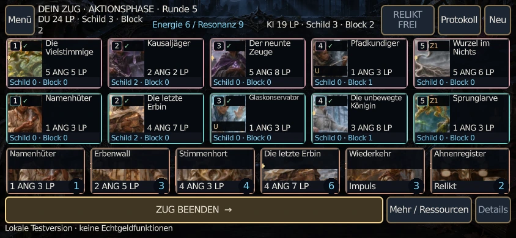
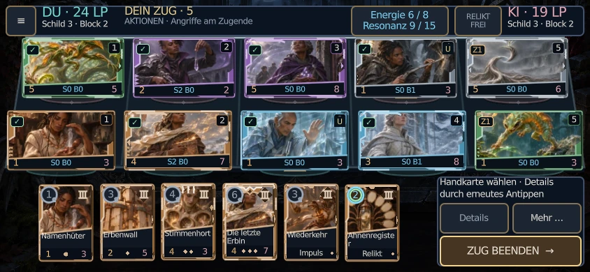
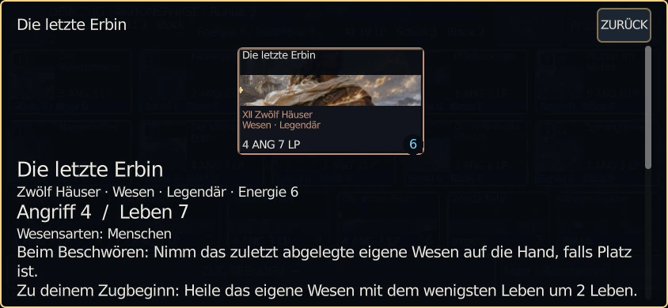
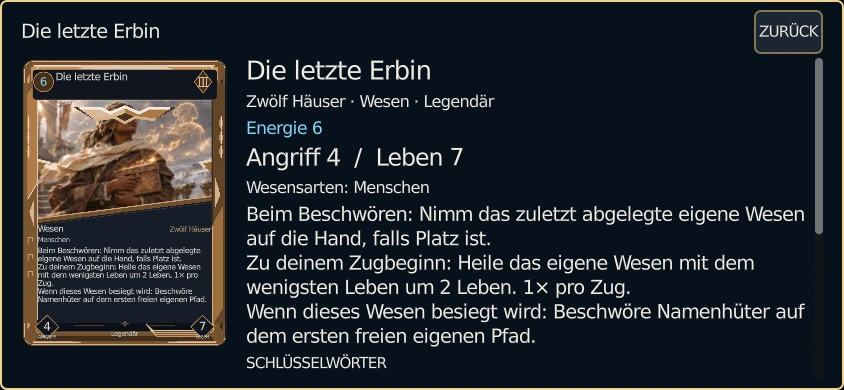
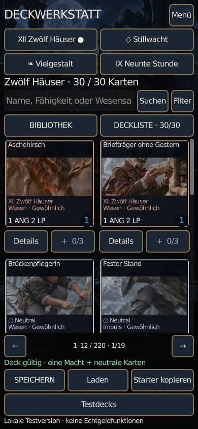
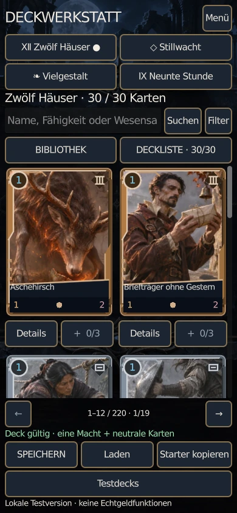
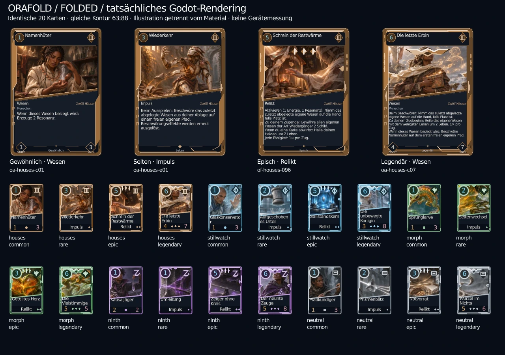
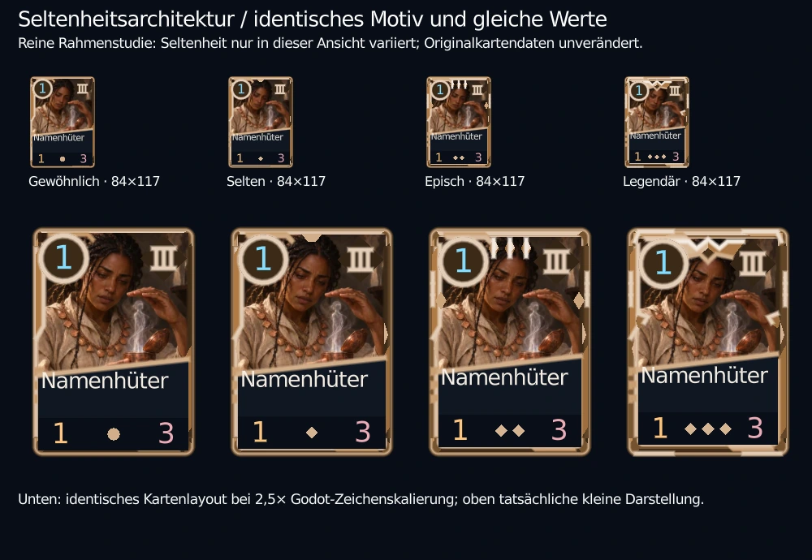

# ORAFOLD Premium Mobile

Base: Develop `10782185cf41f2013607ba47da0bbfcb737e89e2`.
This package changes presentation, input safety, Web-App support and one measured
reference deck. It does not change the 550 card definitions, combat rules,
resource limits, starter decks, canonical lore or the active Pages publisher.

## Actual before / after

These are actual Godot framebuffers, with the same sixteen card IDs and identical
arranged model snapshots. This full-field visual fixture is **not** counted as a
played match. Original PNGs, hashes and snapshots are retained in the QA artifacts;
the WebP previews below preserve composition and are encoded at quality92.
The baseline is10782185; the comparison capture is local integration4fdcd4c.
Subsequent input/transport hardening does not alter these visual components.
The final CI repeats native rendering and real browser play on its exact SHA.

| Battle at 844×390: before | Battle: after |
| --- | --- |
|  |  |

The hand changes from six133×80 strips to six approximately83×115 portrait cards.
Selection reserves ten percent extra size without covering neighbouring costs or
values. Creature slots devote their compact area to illustration and permanent
attack, life, shield, block and readiness. Tapping reveals complete names/rules.
The44px HUD and contextual dock replace permanent log/restart rows.

| Inspection: before | Inspection: after |
| --- | --- |
|  |  |

The inspector is an opaque, scrollable information surface with an undistorted
63:88 face and large complete rules. Hand cards cannot render over it. It has one
clear back action. Details, targeting and cancellation remain separate from the
original rule-relevant draw/main/pending-choice phases.

| Portrait deckbuilder: before | Portrait deckbuilder: after |
| --- | --- |
|  |  |

Library geometry now uses the actual pane width and canonical card proportions.
Search, filters, bounded12/24-card pagination,30-card validation, saving/loading
and four starter templates remain functional. A single search result retains its
card shape. Scrolling can intentionally clip a tile; details/add controls still
need an exposed44px touch region.

## Shared materials and spatial decision

Three actual frame renderers were compared using the same twenty production
cards. Folded continues the diagonal identity with filled metal folds, power
sigils, epic crystal structures and a broad legendary architecture. Cost, name
and values draw above ornaments. Silhouette and card back remain common.
The controlled rarity study changes only the preview renderer's rarity setting;
it does not introduce another playable definition or change card values.

See [card materials](../design/PREMIUM_CARD_MATERIALS.md) and the complete
[flat / 2.5D / real3D comparison](SPATIAL_COMPARISON.md). All three variants can
run the existing Shell/Session/engine through a developer-only scene. Normal play
uses2.5D with upright touch controls. No extra public route or legacy switch is
introduced. The true3D variant is locally faster on llvmpipe but sacrifices much
of the illustration area; this is not a physical-phone performance comparison.

## Functional delivery and proof

- [QA status, commands and limits](QA_REPORT.md).
- [PWA, supported fullscreen and verified local duel resume](PWA.md).
- [Responsive collection geometry](LIBRARY_GEOMETRY.md).
- [Measured eight-copy Block reference-deck improvement](BALANCE.md).
- [Inactive, exact-commit one-click release proposal](RELEASE_AUTOMATION.md).
- [Initial audit and implementation packages](IMPLEMENTATION_PLAN.md).

The unchanged production model remains the only source of battle rules. Empty
opposing paths still receive direct hero attacks, with block before shield/life.
All550 active cards remain available;100 Legacy cards stay separate regression
references. Local economy, provisional campaign, audio and two-player systems
are retained. Public online play still requires a reachable authoritative server.

The Web-App is online-first: installation removes browser chrome where the OS
supports standalone apps, but does not download hundreds of megabytes for offline
play. iPhone users receive Safari's real Home-Screen installation instructions;
no forced orientation or artificial90-degree canvas rotation is used. The prior
Safari viewport correction is preserved byte-for-byte.

## Remaining release boundary

Physical iPhone/Android acceptance and hardware GPU/battery measurements remain
open. Automated WebKit is not a physical Safari test. The balance evidence is a
paired heuristic-AI sample, not certification of the entire human metagame.
Illustration file validity and visual review do not grant new commercial legal
clearance. No real-money functionality or paid infrastructure is added.

This feature PR does not publish or merge itself. The manual Pages workflow and
its guard remain unchanged. The staged one-click replacement requires the user's
separate explicit activation approval; active GitHub protections remain enforced.
