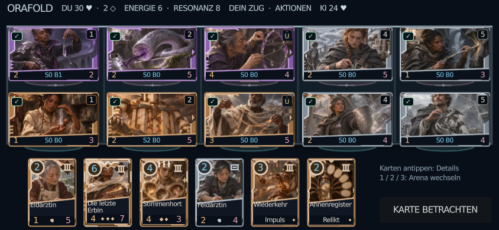
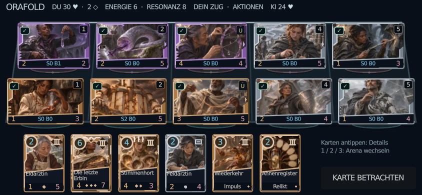
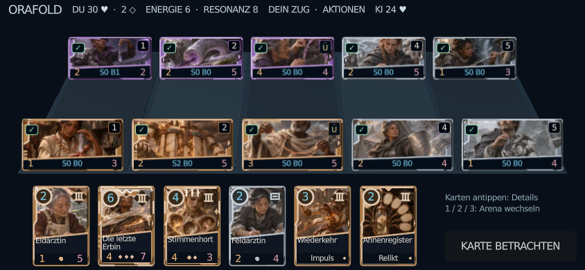

# Räumliche Arena: Vergleich und Auswahl

## Entscheidung

**Die normale Kampfarena verwendet 2,5D (`spatial`).** Der perspektivische Boden, die schmalere Fernreihe, Podeste, Schatten und die beleuchtete Vorderkante schaffen Tiefe. Karten, Werte und Touchflächen bleiben aufrecht. Gegenüber dem flachen Entwurf kostet dies bei 844×390 nur 2,7 % der konservativ gemessenen Illustrationsfläche.

Die echte 3D-Variante bleibt als lauffähiger Entwicklervergleich erhalten. Sie ist im lokalen Software-Rendering schneller, zeigt aber bei derselben Telefonauflösung rund ein Drittel weniger Kartenfläche und 47 % weniger sichtbare Illustration als 2,5D. Die Fernreihe schrumpft von 97 auf 67 Pixel Höhe; der breite räumliche Zwischenraum verdrängt Karteninhalt. Deshalb rechtfertigt der räumliche Eindruck hier keine Ablösung der besser lesbaren 2,5D-Arena. Eine zweite unabhängige Sichtung durch den QA-Agenten bestätigt diese ergonomische Auswahl.

Diese Entscheidung behauptet keine gemessene Überlegenheit auf physischen Mobilgeräten. Dafür stehen keine Geräte zur Verfügung.

## Drei tatsächlich lauffähige Varianten

| Modus | Umsetzung | Spiel und Eingabe |
| --- | --- | --- |
| `flat` | Optimierte direkte Canvas-Komposition; zwei Reihen und fünf gerade Pfade. | Gemeinsame Shell, Session, Karten und Kampfregeln. |
| `spatial` | Perspektivischer 2D-Boden; Fernreihe 95 % breit, um 2,5 % eingerückt; Tiefenkante und elliptische Podeste. | Aufrechte rechteckige Controls; kein perspektivisch verzerrter Text oder Canvas. |
| `three_d` | Eigene `SubViewport`, echte `Camera3D`, 26 `MeshInstance3D`: Tisch, fünf Pfade, zehn Podeste und zehn Kartenquads; eine Lichtquelle, keine Echtzeitschatten oder Partikel. | Zehn echte CardView-Komponenten rendern ihre Flächen in SubViewports. Die projizierten sichtbaren Rechtecke bilden präzise Touchflächen. |

Die normale Startszene bleibt unverändert auf der gemeinsamen Alpha-Shell. Es gibt keinen zusätzlichen öffentlichen Ansichts- oder Legacy-Umschalter. Alle drei spielbaren Varianten lassen sich ausschließlich über die Entwicklerszene starten:

```sh
godot4 --path . --scene res://scenes/premium/arena_playable.tscn -- --arena-mode=flat
godot4 --path . --scene res://scenes/premium/arena_playable.tscn -- --arena-mode=spatial
godot4 --path . --scene res://scenes/premium/arena_playable.tscn -- --arena-mode=three_d
```

Der kleine Adapter setzt nur die Darstellungsvariante und ruft die normale `Shell._ready()` auf. Hauptmenü, vier Starterdecks, Vorbereitung, KI, Spielaktionen, Ergebnis und Replay kommen aus derselben Anwendung. Er benötigt die integrierte Premium-Shell aus dem Arena-Arbeitspaket; er enthält weder eine zweite Engine noch eigene Kartenregeln.

Zusätzlich existiert `scenes/premium/arena_comparison.tscn` als ausdrücklich **eingefrorene, interaktive Sichtprobe**. Sie zeigt in allen Varianten exakt dieselben zehn Wesen und sechs Handkarten aus dem aktiven 550er-Katalog. Spieler: Zwölf Häuser plus Neutral; Gegner: Neunte Stunde plus Neutral. Alle drei Kartentypen und vier Seltenheiten sind vertreten. Antippen öffnet eine unverzerrte 63:88-Detailkarte; 1/2/3 wechseln die Ansicht. Die Sichtprobe führt keine Spielzüge aus und zählt nicht als gespielte Partie.

## Vergleichbare Godot-Renderings

Die drei Bilder stammen aus dem tatsächlichen Godot-Framebuffer bei 844×390. Auch 852×393 und 932×430 wurden in allen drei Varianten gerendert; vollständige Zustands-, Asset-, Geometrie- und Leistungsdaten stehen im [Messprotokoll](evidence/arena-performance.json).

**Optimiertes flaches 2D**



**Gewählte 2,5D-Arena**



**Echte 3D-Arena**



## Geometrie bei 844×390

| Variante | Summe Touch-/Kartenrechtecke, px² | Sichtbare Illustration, px² | Kleinste Kartendimension | 3D-Meshes / SubViewports |
| --- | ---: | ---: | ---: | ---: |
| Flach 2D | 153,030 | 73,704 | 97.1 px | 0 / 0 |
| 2,5D | 149,048 | 71,737 | 97.1 px | 0 / 0 |
| Echtes 3D | 102,142 | 37,970 | 66.6 px | 26 / 11 |

Die Illustrationsfläche ist eine konservative Layoutmessung des tatsächlichen Renderers: Illustrationsöffnung abzüglich opaker Namens-/Werteflächen, Medaillons und Rahmenstruktur. Sie ist kein subjektiver Qualitätswert und keine hochgerechnete Texturauflösung. Bei 3D wird dieselbe lokale Fläche auf das tatsächlich projizierte Kartenrechteck umgerechnet. Der gemeinsame Zustand hat SHA-256 `a35e87a5a3fab6a484e02c5c41f44c5067d55d3d6e07912cc98f1af6b75ae957`.

Die Vergleichsszene hat bei 844×390 eine Bodenfläche von 820×208,2 Pixeln. Die echte Premium-Shell nutzt je nach Header und Hand einen anderen verfügbaren Bereich; das tatsächlich aufgetretene 828×194,97-Profil ist zusätzlich streng geprüft. Damit wird die isolierte Sichtprobe nicht als vollständiger App-Leistungstest ausgegeben.

## Leistung und Ressourcen

Godot 4.6.3, GL Compatibility, Linux/X11, Mesa llvmpipe LLVM 19.1.7, zwei verfügbare CPU-Kerne. Je Variante und Auflösung: 30 Einlaufbilder, danach 90 gemessene Bilder. GPU-Fenster liefen seriell; die Cloud-CPU wird geteilt. Framezeiten enthalten Software-Rendering, Treiber und Scheduling. Sie sind **keine iPhone-/Android-FPS** und keine isolierten GPU-Zeitstempel.

| Viewport | Variante | Framezeit p50 / p95, ms | Draw Calls, letztes Bild | RSS-Spitze, MiB | Godot-Videospeichermonitor, MiB |
| --- | --- | ---: | ---: | ---: | ---: |
| 844×390 | Flach 2D | 107.75 / 139.30 | 926 | 245.3 | 29.9 |
| 844×390 | 2,5D | 133.11 / 146.29 | 937 | 264.1 | 29.9 |
| 844×390 | Echtes 3D | 84.64 / 141.99 | 463 | 253.9 | 34.0 |
| 852×393 | Flach 2D | 130.88 / 147.45 | 926 | 260.0 | 30.0 |
| 852×393 | 2,5D | 129.75 / 144.55 | 937 | 244.9 | 30.0 |
| 852×393 | Echtes 3D | 116.62 / 146.76 | 463 | 245.5 | 34.1 |
| 932×430 | Flach 2D | 115.17 / 141.57 | 926 | 246.4 | 30.5 |
| 932×430 | 2,5D | 119.72 / 141.68 | 937 | 265.0 | 30.5 |
| 932×430 | Echtes 3D | 78.70 / 144.47 | 463 | 245.9 | 35.1 |

RSS wird am realen Godot-Prozess alle 100 ms gelesen; es ist eine beobachtete Stichprobenspitze, kein exaktes Kernel-Maximum. Der Videospeicherwert ist der Godot-Monitor des Software-Treibers. Ein GPU-Timestamp ist über diesen Messpfad nicht verfügbar.

3D benötigt weniger wiederholte Zeichenaufrufe, weil die zehn gerenderten Kartenflächen nach erfolgreicher Assetbindung eingefroren werden. Das erklärt den lokalen Vorteil; es belegt keine generelle GPU-Überlegenheit von 3D. Eine entsprechende Raster-Cache-Optimierung für 2D wäre ein getrennt zu prüfender Folgeschritt. Alle Varianten verwenden denselben vorhandenen 32-MiB-Assetcache; nur sechzehn sichtbare Originalillustrationen werden gebunden.

Auch `_ready` bis zum ersten dargestellten Bild und bis zur Bindung sämtlicher sichtbarer Bilder werden aufgezeichnet. Die Werte liegen im Rohprotokoll. Sie enthalten native Dateizugriffe und warme Shader-/Betriebssystemcaches; Katalogkonstruktion, WebAssembly-Download und Browserstart sind nicht darin enthalten. Deshalb werden sie nicht als Web-Ladezeit ausgegeben. Der Standard-Webexport und seine Downloadgröße ändern sich nicht allein durch die Arenaansicht.

## Testnachweise und behobene Fehler

- **2.830 Geometrie-/Projektionsprüfungen bestanden:** flache und räumliche Trefferflächen, fünf Pflichtauflösungen, mindestens 44 Pixel, alle Eckpunkte, keine Überschneidung, korrekte logische Pfadzuordnung; echte Kamera-/Mesh-Konstruktion und Projektion. Zusätzliche Grenzen 88/99/100/101 Pixel Boardhöhe und die realen Profile 828×194,97, 720×184 und 576×160. Die tatsächlichen 3D-Karten übernehmen Zielmarkierung, Auswahl, Bereitschaft, Schwächung, Schild/Block und Konvergenz; die Projektion verändert keine vom Aufrufer übergebenen Daten. Leere gültige Pfade frieren ohne eine nicht vorhandene Illustration korrekt ein.
- **829 integrierte Shell-Prüfungen bestanden:** `tests/premium_battle_geometry.gd`, Arena-Stand `0f332fc`, Stage `e77036a`, Kartenrenderer `3930222`. Die Folge flach → 2,5D → 3D → 2,5D erhält vollständigen Snapshot, Ereignisse, RNG-State/-Aufrufzahl, Commands und Auswahl bytegleich. Bei 844×390 ist echte 3D-Projektion aktiv, nicht die Schutzrückfallebene. Inspektion bleibt unverzerrt 63:88. Dies sind angeordnete UI-Zustände, keine zusätzlich gezählten vollständigen Partien.
- **Neun Render-/Messläufe bestanden:** gleiche Karten und Zustand, sechzehn reale gebundene Illustrationen je Bild, keine ausstehenden Assets, 384-Pixel-Stichprobe gegen Schwarz-/Leerbilder, tatsächliche 3D-Kamera und eingefrorene 3D-Kartenflächen. PNG-Hashes sind protokolliert.
- **Framingfehler behoben:** Ein nur auf Breite optimierter Kamerawinkel schnitt auf dem realen 828×194,97-Board 5,8 Pixel der eigenen Reihe ab. Die vertikale Mindestöffnung von 29° behebt dies; die Grenze wurde nicht aufgeweicht.
- **Sehr niedriger Safari-Bereich:** Unter 101 Pixel Boardhöhe entfällt zuerst der dekorative Mittelabstand. Auf 88 Pixel bleiben zwei echte 44-Pixel-Reihen. Passt eine 3D-Projektion nicht sicher, bleiben aufrechte 2D-Touchflächen über dem tatsächlichen 3D-Boden erhalten.
- **Fehlerhafte Sichtproben brechen ab:** Unbekannte Karten-IDs, fehlende Bildbindungen, schwarze Framebuffer und unvollständige 3D-Flächen erzeugen keinen bestandenen Nachweis.

```sh
LP_NUM_THREADS=1 godot4 --headless --path . --script res://tests/premium_arena_geometry.gd
LP_NUM_THREADS=1 godot4 --headless --path . --script res://tests/premium_battle_geometry.gd
DISPLAY=:99 LP_NUM_THREADS=1 python tools/premium/run_arena_comparison.py \
  --out "$PWD/work/arena-comparison" --frames 90 --warmup 30
```

Falls die Standard-Godot-Datenverzeichnisse nicht beschreibbar sind, `XDG_DATA_HOME` und `XDG_CACHE_HOME` auf beschreibbare Testverzeichnisse setzen. Der Renderer erfordert für echte Bilder ein vorhandenes Display; Headless-Geometrie wird nicht als Screenshotnachweis ausgegeben.

## Geltungsbereich

Die Leistungsreihe wurde am lokalen Komponentenstand `e77036a85185f59f7b9c18c568b4483a9a5cd953` aufgenommen. Alle relevanten Renderdateien sind im JSON mit SHA-256 verzeichnet und gegen den Commit geprüft. Eine temporär für den spielbaren Integrations-Smoke übernommene Shell wurde von dieser isolierten Szene nicht geladen; der aufgezeichnete Worktree-Status nennt dies offen. Die finalen Abbildungen kürzen anschließend ausschließlich die Entwickler-Tastaturlegende, damit sie vollständig in ihren Bereich passt; Geometrie, Bilder, Kartenrahmen und Spielzustand bleiben gleich. Dieser kleine Sichtnachweis ist separat mit den unveränderten Karten-/Geometriedaten im [visuellen Protokoll](evidence/arena-visual.json) versioniert: lokaler Stand `16d0d248b030d9fa6c7fcdf73edf90f616e21980`, sauberer Worktree, sämtliche Renderdateien gegen den Commit geprüft. Die jeweils zwölf gemessenen Frames dieses kurzen Sichtlaufs sind ausdrücklich kein zweiter Leistungsbenchmark; die Tabelle verwendet weiterhin die vollständigen 90er-Reihen. Die WebP-Vorschauen sind verlustfrei und nach Dekodierung pixelidentisch zu den unveränderten Original-PNGs; beide Dateihashes und der gemeinsame Pixelhash sind protokolliert.

Die normale 2,5D-Arena erzeugt keine 3D-SubViewports, Schattenpässe oder zusätzlichen Texturen. Die fünf logischen Pfade und die bestehende direkte Heldenangriffsregel sind unverändert. Reaktions-, Energie-, Resonanz-, Block-/Schild- und Sieglogik kommen weiterhin ausschließlich aus dem bestehenden Modell.

Offen bleiben physische iPhone-/Android-Abnahme, belastbare Hardware-GPU-Messungen und Retina-/Web-Leistungsabnahme der nur als Entwicklervergleich erhaltenen 3D-Variante. Chromium/WebKit, PWA, vollständige Partien, Gesamtregression und der exakte spätere Integrationscommit werden im übergreifenden Premium-QA-Bericht getrennt nachgewiesen. Diese Messdatei ist keine Pages-Releasefreigabe; die bestehende Veröffentlichungssperre bleibt unverändert.
