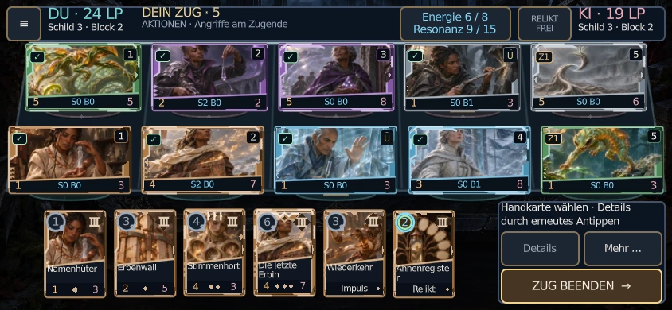
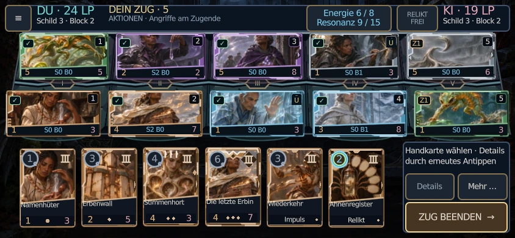
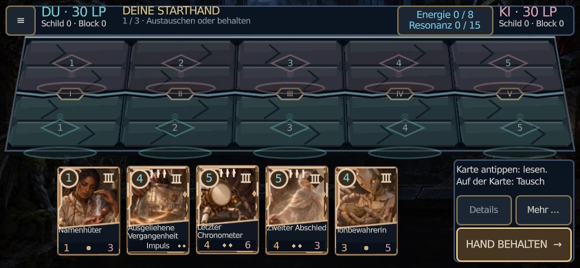
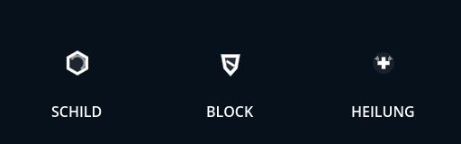

# Mobile arena: actual before and after

Before: develop81ec5701. After: local integrated source `b1bfc8d8eccca9f2c88cef91c0925762369b43ff`, which contains the preceding card-inspection changes plus this arena. These are actual Godot4.6.3 Compatibility/Xorg/Mesa llvmpipe screenshots at844×390; no physical iPhone/Android claim. WebP previews preserve pixel dimensions, with quality94; the source PNG and preview hashes are recorded separately.

| Before | After |
| --- | --- |
|  |  |

Both full-field captures use the same deterministic IDs and deliberately arranged board/hand state. They prove presentation, not a legal finished duel. The read-only native fixture records the complete actual model and control geometry in [native-manifest.json](native-manifest.json).

## Actual opening with free paths



This additional capture starts a real seeded match through the existing Shell entry point. It shows the actual five starting cards and free opposing paths. A card tap now inspects; exchanging is explicit. The larger illustrated hand, continuous carved paths, opposing materials, narrow central fold and existing immutable ten logical hit rectangles share the screen. Secondary details/log controls retain their existing menu.

Reproduce with the committed fixture:

```sh
godot --path . --audio-driver Dummy --script tools/premium/render_arena_qa.gd -- --output=res://work/mobile-arena-review --include-opening
```

The default command still produces its original nine main captures, plus the separate effect fixture. The optional opening adds one capture; no gate, old comparison mode or assertion has been removed. Experimental actual3D remains available, and the original3D viewports are still tested alongside five actual phone/desktop board dimensions.

## Distinct short defense feedback



Actual shield, block and heal rasterizations use the same white pigment and age; their pixel masks are nonempty and pairwise different. This is a presentation fixture and never fabricates battle damage. Existing bounded duration,24-job limit and reduced-motion behavior remain in place.

## QA scope

The stand-alone arena tests pass7455 layout assertions,30597 card-name/creature-text assertions,3158 arena/3D geometry checks and997 original Shell checks. The combined inspection/arena passes eight real Godot suites:3399,1018,112,3852,353,4439,96 and430 assertions, all zero failures. The tests cover actual taps, explicit selection, Mulligan, both opening sides, invalid/cancelled drag, rotation, replay, six-card layout and every550 original card name. They do not establish550 finished games or mobile-GPU performance.

The initial tighter short-height layout failed357 illustration checks and one full-name check. Responsive height budgeting removed the357; widening the bounded nameplate removed the remaining two short-height title failures. All thresholds stayed intact. Full exact-head CI, both hosted browser engines, fresh merge QA and confirmed automatic publication remain separate required gates; their final results belong in the PR. No game rules, cards, artwork, economy, lore, global frame defaults or publisher changed.
