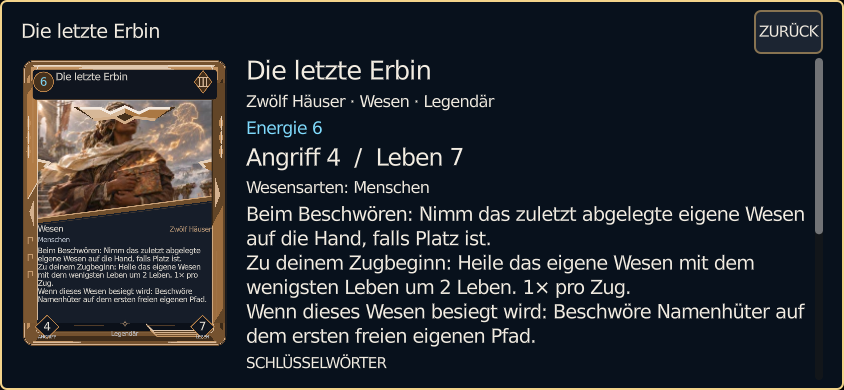
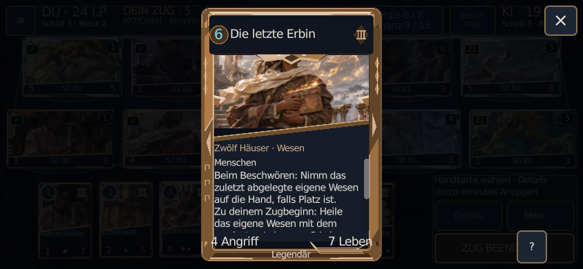
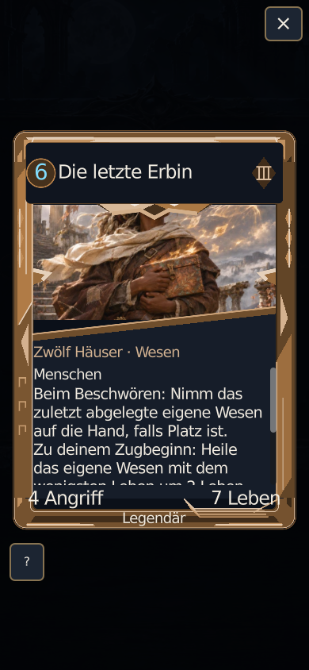

# Actual mobile inspection captures and local QA

Before: develop `81ec5701d1600f2e80738a2dd0b3a05a9f9973a0`. After UI: `e8c43ab570b63f2ca6acf56d523eeea6ea4064f5` (local source tree also preserved in the PR's production commits). Actual Godot 4.6.3 Compatibility renders on Linux/Xorg/Mesa llvmpipe. These are arranged presentation fixtures, not physical iPhone tests or played-game evidence. Ten captures completed without script/runtime errors; unsupported VSync is the software-driver warning.

| Before, 844×390 | After, 844×390 | After, 390×844 |
| --- | --- | --- |
|  |  |  |

The complete original card, native illustration, existing frame, original title/rules and current values remain inside one 63:88 card. The printed rules area scrolls internally at a minimum 13 CSS pixels; keyword definitions are separate. The long-text image deliberately shows an internally scrollable card, not a claim that 295 characters fit simultaneously in a 390-pixel-tall viewport.

## Actual local checks

| Native suite | Assertions | Failures |
| --- | ---: | ---: |
| mobile_card_inspection | 3399 | 0 |
| premium_battle_geometry | 1018 | 0 |
| premium_drag_cancel | 112 | 0 |
| master550_opening_ui | 3852 | 0 |
| alpha_ui, successful rerun | 351 | 0 |
| alpha02_ui | 4439 | 0 |
| alpha03_orientation | 96 | 0 |
| production_short_landscape | 430 | 0 |

Runs cover the production code before the final guidance-only tooltip correction; screenshots cover that corrected UI. These development receipts do not substitute for full CI on the final PR head or fresh merge-commit QA. Native opening and drag cases use real commands and verify replay; the 550-source-text probe is explicitly a text-layout/unchanged-data check. All old suites and leak/error guards remain enabled. Local alpha_ui assertion totals depend on the saved local seed; only the successful 351-assertion rerun is claimed here.

The first new fixture had an Array/Dictionary hash type error, corrected without removing assertions. One opening attempt incorrectly used a headless renderer for screenshot capture; another alpha_ui attempt lacked its wrapper-created output directory and reported PNG save errors. None is counted as passed. Corrected runs retained full error/leak checks. Browser, complete final-head CI, merge QA and public publication are pending at this receipt's creation; their actual results must be recorded in the PR before integration. The unit report records 187 Node and 53 Python passes separately.

Physical iPhone and Android acceptance remains open. The new frame design has not been selected or rolled out by this PR.
